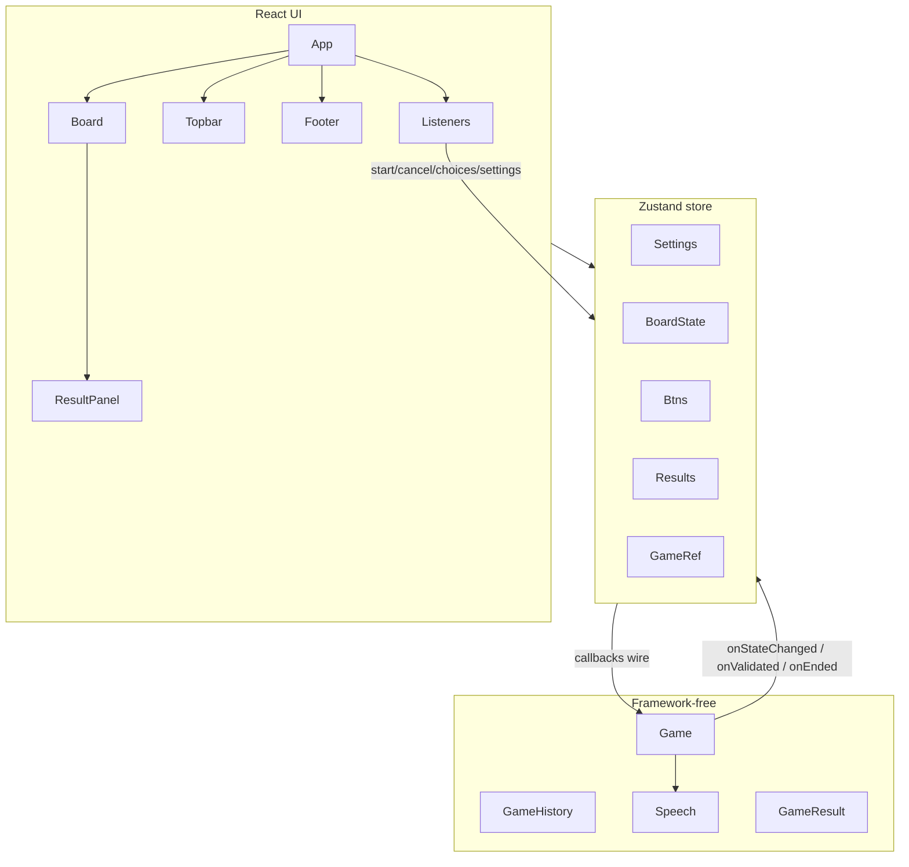
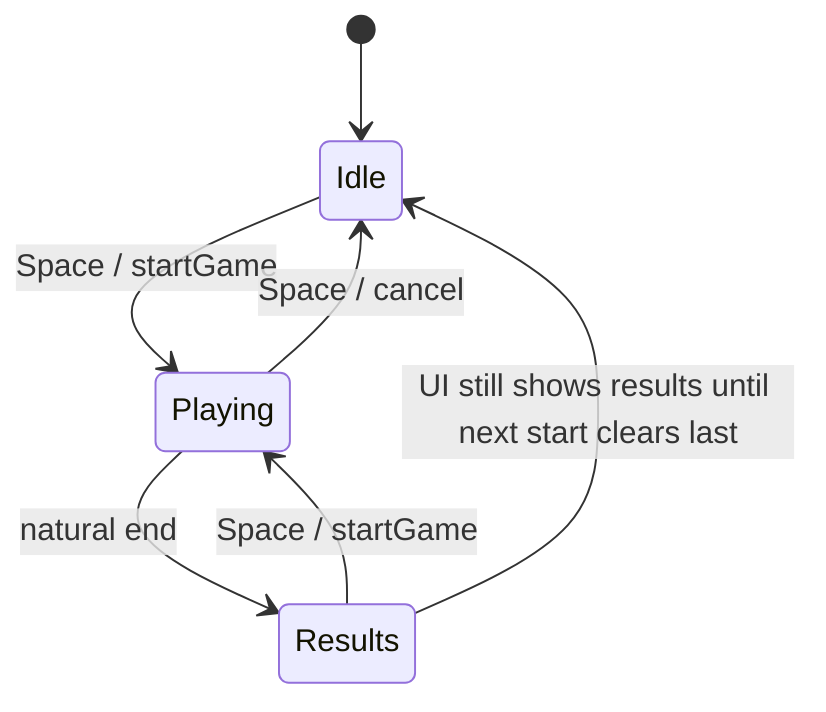

# SolidJS to React Migration - Plan

## Goal Capsule

Migrate the dual n-back SPA from SolidJS to React with behavior parity (game rules, timing, keyboard map, audio, results) and a clean React foundation for later feature work.

**Authority:** this plan > current Solid source behavior > new preferences. Do not invent product features.

**Stop when:** Solid dependencies are gone, `pnpm build` succeeds, domain characterization tests pass, and a manual parity checklist for one full session succeeds.

**Out of scope for executors:** new game modes, UX redesign, settings persistence, mobile apps.

---

## Product Contract

### Summary

Port the cloned dual n-back app from SolidJS to React so future expansion happens on a mainstream React stack, without changing how the game plays today.

Product Contract preservation: Product Contract authored in this bootstrap (no upstream brainstorm).

### Problem Frame

The app is a working SolidJS + SUID dual n-back trainer. The owner wants to expand it on React. A mechanical framework swap is required before feature work; domain logic (`Game`, scoring, Howler speech) should survive with minimal drift.

### Requirements

**Parity**

- R1. A full dual n-back session matches current rules: n-level, trial count, rest/interval timing, position+audio stimuli, match validation, and end-of-game scoring.
- R2. Keyboard controls stay: `Space` start/cancel, `A` position match, `L` audio match, arrows adjust level/trials with the same bounds as today.
- R3. Visual feedback timing stays: ~1s board highlight clear, ~500ms button success/error clear.
- R4. Letter audio still plays via Howler for each stimulus; wav+mp3 fallback order preserved.
- R5. Idle / in-game / results UI transitions match current layout roles (topbar+footer when idle; board+trial notice+match buttons when playing; results when a session ends).

**Platform**

- R6. App runs on React + Vite + TypeScript with no Solid runtime remaining.
- R7. Material UI replaces SUID for the few Material components in use (topbar chips/typography).
- R8. Existing Sass and CSS-variable theme system continue to drive look-and-feel (no redesign).
- R9. Project layout supports later features (clear domain vs UI vs store boundaries) without adding unused feature code now.

### Actors

- A1. Player — practices dual n-back via keyboard and on-screen board.

### Key Flows

- F1. Start session — from idle, `Space` creates a game, optional fullscreen, stimuli begin.
- F2. Trial cycle — rest delay → stimulus (position + letter sound) → response window → validate → next trial until length exhausted.
- F3. Respond — during response window, `A`/`L` (or on-screen buttons) record position/audio claims; feedback classes update then clear.
- F4. Cancel — `Space` during play stops the loop, clears board state, exits fullscreen, returns to idle without a last result.
- F5. Results — on natural end, results panel shows last `GameResult`; session history accumulates in memory for the page lifetime.
- F6. Adjust settings — arrows change level/trials with existing min/max coupling; no settings drawer required for parity (drawer remains unused stub today).

### Acceptance Examples

- AE1. Covers F1/F2. With defaults (level 5, 30 trials, 3000ms interval, 300ms rest), starting a session shows the board, countdown trials, and audible letters until completion yields a results panel.
- AE2. Covers F3. Pressing `A` when position matches n-back marks success feedback; pressing when it does not marks error (after enough history exists); early trials with a press fail as today.
- AE3. Covers F4. Mid-session `Space` returns to idle with no `results.last` and board cleared.
- AE4. Covers F6. `ArrowUp` raises level and may raise trials to `(level+1)*2` when needed; `ArrowDown` floors level at 2.

### Success Criteria

- Solid packages removed; React app builds and serves.
- Characterization tests lock `Game` / `GameResult` behavior.
- Manual checklist for F1–F6 passes once.

### Scope Boundaries

**In scope:** toolchain swap, domain decoupling, React store/hooks/components, MUI swap, sound path fix for configurable `base`, CI/README updates for the new stack.

**Deferred to Follow-Up Work:** settings drawer UX, localStorage persistence, new modalities/modes, routing, dark/light theme picker beyond current CSS vars, GH Pages base path for a new fork URL (set when deploy target is known).

**Outside this product's identity:** redesigning the trainer experience; backend/accounts.

### Dependencies

- pnpm, Node compatible with chosen Vite major.
- Existing `src/sounds/` letter assets (present in repo).

---

## Planning Contract

### Key Technical Decisions

- KTD1. Use React 19 + Vite (current stable 6+) + TypeScript 5.x + `@vitejs/plugin-react`; remove `solid-js`, `vite-plugin-solid`, `@suid/material`, `solid-icons`. (session-settled: user-approved — chosen over strict Solid-era pin: modest modernization while converting)
- KTD2. Use Zustand for session/UI state (settings, board, buttons, results, active game handle); keep `Game` as a framework-free class with injected callbacks. (chosen over Context+useReducer: high-frequency board updates and outside-React access match the current singleton store pattern)
- KTD3. Use MUI (`@mui/material` + Emotion + `@mui/icons-material`) only where SUID/solid-icons were used; Sass + CSS variables remain the primary look system. (session-settled: user-approved — chosen over Sass-only: closest Material parity)
- KTD4. Decouple shared types (`BoardState`, `GameResult`) into `src/model/` before rewriting UI so `Game` no longer imports the store.
- KTD5. Add Vitest characterization tests for domain logic before rewriting React glue; inject RNG/clock seams only as needed for determinism.
- KTD6. Move letter sounds to `public/assets/sounds/letters/` and build Howler `src` with `import.meta.env.BASE_URL`; remove `vite-plugin-static-copy` and hardcoded `./assets/...`. Vite `base` defaults to `'/'` until a Pages subpath is chosen. (chosen over Vite `?url` imports: fixed filenames + Howler string paths match current Speech shape)
- KTD7. Keep Strict Mode on; keyboard listener and game session must be idempotent (effect cleanup, cancel token / `stop()` clears pending work).
- KTD8. Organize for expansion: `src/model/` (domain), `src/store/` (Zustand), `src/hooks/` (keyboard/theme), `src/components/` (UI). No router until a feature needs it. (session-settled: user-approved — chosen over minimal parity-only file churn)

### Assumptions

- Deploy `base` defaults to `'/'`; GitHub Pages workflow still builds `dist/` — update `base` later when the fork’s Pages URL is known.
- SettingsPanel/Drawer stub is out of the critical path; delete or leave unmounted. Keyboard settings satisfy R2/F6.
- `boardState.letter` remaining unused in UI during play is intentional parity (letter drives audio via callback only).
- Numbers sounds under `src/sounds/numbers/` stay unused (not referenced by current Speech).

### High-Level Technical Design

### Sequencing

1. Toolchain + empty React shell builds.
2. Domain decoupling + Speech/`public` assets + characterization tests.
3. Zustand store + game bridge + Strict Mode–safe session lifecycle.
4. Hooks (keyboard, theme CSS vars).
5. Component port + MUI.
6. Docs/CI + manual parity gate.

### System-Wide Impact

- **Entry / build:** `index.html` → React `createRoot`; Vite plugin and `jsx` settings change; CI still builds `dist/` but `base` must match the eventual Pages path.
- **Session lifecycle:** Idle ↔ Playing ↔ Results is owned by Zustand + `Game.start`/`stop`; cancel and Strict Mode remounts must not leave orphan timers or duplicate keydown listeners.
- **Audio:** Howler instances live with the store/speech singleton; asset URLs couple to Vite `base` — wrong prefix fails only at runtime.
- **No persistence / no multiplayer:** in-memory session history only; no server contracts to migrate.

### Risks & Dependencies

| Risk | Mitigation |
|------|------------|
| Async loop + Strict Mode double-start | Session cancel flag; `stop()`; listener mounted once |
| Timing drift if delays rewritten carelessly | Characterization with fake timers; keep `restDelay`/`intervalTime`/`1000`/`500` constants |
| Broken audio after `base` change | `BASE_URL`-aware paths; smoke-play one letter in browser |
| MUI + Sass visual drift | Map only chips/typography/icons; keep SCSS classnames |
| No prior automated tests | Characterization gate before deleting Solid store |

### Sources & Research

- Repo: Solid store singleton (`src/store/index.tsx`), `StoreGame` bridge, `Game` async loop, Pages workflow, Vite `base` full URL.
- External (load-bearing): Zustand for high-churn client state; Strict Mode effect cleanup; Vitest characterization before framework rewrite; prefer `public/` + `BASE_URL` or Vite URL imports over brittle relative Howler paths.

---

## Implementation Units

### U1. React toolchain and empty shell

**Goal:** Replace Solid tooling so a React app mounts at `#root`.

**Requirements:** R6

**Dependencies:** None

**Files:**
- Modify: `package.json`, `pnpm-lock.yaml`, `vite.config.ts`, `tsconfig.json`, `index.html`
- Create: `src/main.tsx` as the React entry; remove `src/index.tsx` once wired
- Modify: `.github/workflows/pages.yml` only if Node/pnpm pins need bump for new Vite
- Test expectation: none — smoke build only

**Approach:** Add React 19, `@vitejs/plugin-react`, TypeScript 5.x, keep Sass. Remove Solid packages and `vite-plugin-static-copy` (sounds move to `public/` in U2). Temporary minimal `App` that renders a placeholder is OK until U5. Set `base: '/'` for now. Keep `server.port` 3000.

**Patterns to follow:** Official Vite React-TS template `jsx: react-jsx`, `createRoot` + `StrictMode`.

**Test scenarios:**
- Happy path: `pnpm install` and `pnpm build` succeed with React plugin.
- Edge: `index.html` script points at the React entry; `#root` exists.

**Verification:** Dev server serves the React shell without Solid errors.

---

### U2. Domain decoupling, audio paths, and characterization tests

**Goal:** Make game logic framework-free, fix Howler asset URLs, and lock behavior with tests before React glue lands.

**Requirements:** R1, R3, R4; F2; AE2

**Dependencies:** U1

**Files:**
- Create: `src/model/types.ts` (or equivalent) for `BoardState` and related types
- Modify: `src/model/Game.ts`, `src/model/GameHistory.ts`, `src/model/Speech.ts`
- Move: `src/store/GameResult.ts` → `src/model/GameResult.ts`
- Move: `src/sounds/letters/**` → `public/assets/sounds/letters/**` (numbers optional/unused)
- Create: `src/model/Game.test.ts`, `src/model/GameResult.test.ts`, `src/model/Speech.test.ts`
- Create/modify: `vitest.config.ts`, `package.json` scripts (`test`)
- Execution note: Characterization-first — lock `Game` behavior before rewriting React layers.

**Approach:** Extract types out of `src/store/index.tsx`. Update `Speech` to prefix Howl sources with `import.meta.env.BASE_URL`. Optionally inject `rng` / delay helpers into `Game` for deterministic tests without changing production defaults. Cover match validation, early-trial failed presses, result aggregation, Speech path construction, and at least one fake-timer trial sequence.

**Patterns to follow:** Keep public `Game` API (constructor callbacks, `start`/`stop`/`addChoice`) stable so U3 can re-bridge cleanly.

**Test scenarios:**
- Happy path: after `n` history, matching position+claim → success; mismatch claim → failed.
- Edge: presses before history length > `n` → failed when claimed.
- Edge: `stop()` mid-`start()` prevents `onGameEnded`; repeated `stop()` is safe.
- Integration: fake timers advance one trial and assert `onStateChanged` then `onPlayerChoiceValidated` order.
- Happy path: Speech builds wav+mp3 URLs under `${BASE_URL}assets/sounds/letters/`.

**Verification:** `pnpm test` green; `Game.ts` / `Speech.ts` import no React/Solid/store modules.

---

### U3. Zustand store and game session bridge

**Goal:** Replace Solid `createStore` / `StoreGame` with Zustand + a bridge that preserves callbacks and timing side effects.

**Requirements:** R1, R3, R5, R9; F1, F4, F5; AE3

**Dependencies:** U2

**Files:**
- Create: `src/store/gameStore.ts` (name flexible)
- Create: `src/store/createGameSession.ts` or `src/store/GameSession.ts` (replaces `StoreGame.ts`)
- Modify/remove: `src/store/index.tsx`, `src/store/StoreGame.ts`
- Test: `src/store/gameStore.test.ts` and/or `src/store/GameSession.test.ts`

**Approach:** Mirror current `State` shape. Actions: start/cancel, selectAudio/selectPosition, settings mutations, board/button updates from callbacks. Preserve 1000ms highlight clear and 500ms button reset via timeouts cleared on cancel. Fullscreen request/exit follows `settings.useFullScreen`. Guard against double-start. Hold game instance in a ref/module field the store can call without putting class instances into reactive snapshots if that causes issues.

**Patterns to follow:** Current `StoreGame` callback bodies in `src/store/StoreGame.ts`.

**Test scenarios:**
- Happy path: start → mock `onBoardStateChange` path updates `boardState` and schedules highlight clear.
- Happy path: validated match sets success/error button states then clears after 500ms (fake timers).
- Edge: cancel clears `game`, resets board, does not push results.
- Edge: second start while active throws or no-ops consistently (match current “already defined” guard).
- Integration: `onGameEnded` pushes `results.all`, sets `results.last`, clears `game`.

**Verification:** Store tests pass; no Solid imports remain in `src/store/`.

---

### U4. Keyboard and theme hooks

**Goal:** Port `createKeydownListener` and `createTheme` to React effects.

**Requirements:** R2, R8; F1, F3, F4, F6 / AE4

**Dependencies:** U3

**Files:**
- Create: `src/hooks/useKeyboardControls.ts`, `src/hooks/useThemeVariables.ts`
- Modify/remove: `src/reactiveAPI/createKeydownListener.ts`, `src/reactiveAPI/createTheme.ts`, `src/components/utils/ListenersSetup.tsx`
- Test: `src/hooks/useKeyboardControls.test.ts` (jsdom)

**Approach:** Single document `keydown` listener with ref to latest actions; cleanup on unmount. Theme hook injects/updates the existing style tag id `app-css-variable-definition` from `DefaultDark` / `themes/config`. Mount both from `App`.

**Patterns to follow:** Key map and settings mutation rules in current `createKeydownListener.ts`; CSS var emission in `createTheme.ts` + `themes/config.ts`.

**Test scenarios:**
- Happy path: `ArrowUp`/`ArrowDown`/`ArrowLeft`/`ArrowRight` mutate settings with same bounds.
- Happy path: `Space` calls start or cancel based on active game.
- Happy path: `a`/`l` call selectPosition/selectAudio only when playing.
- Edge: unmount removes listener (no duplicate handlers after remount).
- Edge: `preventDefault` on handled keys.

**Verification:** Keyboard-driven settings and start/cancel work in dev without duplicate events under Strict Mode.

---

### U5. Port UI components to React + MUI

**Goal:** Rewrite components for React APIs and MUI replacements while keeping Sass structure.

**Requirements:** R5, R7, R8; F5, AE1

**Dependencies:** U3, U4

**Files:**
- Modify: `src/App.tsx`, `src/App.scss`
- Modify: `src/components/Board/index.tsx`, `BoardSquare.tsx`, `Board.scss`
- Modify: `src/components/Topbar/index.tsx`, `Topbar.scss`
- Modify: `src/components/Footer/index.tsx`, `Footer.scss`
- Modify: `src/components/ResultPanel/index.tsx`, `ResultPanel.scss`
- Modify: `src/components/utils/ActionButton.tsx`, `UserMatchNotice.tsx`, `UserMatchNotice.scss`
- Delete or leave unmounted: `src/components/SettingsPanel/index.tsx` (stub; not required for parity)

**Approach:** Replace `Show`/`class`/`classList`/`Component` with React conditionals and `className`. Subscribe to Zustand via selectors to limit re-renders. Swap SUID → MUI (`Typography`, `Stack`, `Chip`, etc.) and solid-icons → MUI icons. Preserve SCSS class names where possible.

**Patterns to follow:** Current component tree in `App.tsx` and Board idle/playing/results branching.

**Test scenarios:**
- Happy path: idle renders Topbar + Board keybinding notice + Footer.
- Happy path: playing hides Topbar/Footer, shows trials notice and match buttons.
- Happy path: when `results.last` set and no game, Board shows ResultPanel.
- Edge: SettingsPanel is not mounted (keyboard settings only).

**Verification:** Visual structure matches current screens; MUI chips show level/trials. Manual smoke is sufficient; optional lightweight render tests if cheap.

---

### U6. Docs, CI, and parity gate

**Goal:** Document the React stack and prove end-to-end parity after UI lands.

**Requirements:** R6; AE1 (full session including audible letters)

**Dependencies:** U2, U5

**Files:**
- Modify: `README.md`
- Modify: `.github/workflows/pages.yml` if Node/base notes needed
- Test expectation: none beyond Verification Contract — audio paths already covered in U2

**Approach:** Document `pnpm dev` / `pnpm test` / `pnpm build`. Note that Pages `base` must be set when publishing to a project subpath. Confirm `vite-plugin-static-copy` and Solid packages are gone.

**Execution note:** Prefer install/runtime smoke for the full session checklist.

**Test scenarios:**
- Integration: browser smoke — start session, hear a letter, complete or cancel per Verification Contract checklist.
- Edge: with temporary `base: '/foo/'`, letter requests still resolve (optional local check).

**Verification:** Manual parity checklist checked off; Solid packages absent from `package.json`; `pnpm build` succeeds.

---

## Verification Contract

**Automated**

- `pnpm test` — domain + store + keyboard characterization/unit tests
- `pnpm build` — production bundle

**Manual parity checklist (once)**

1. Idle UI: topbar level/trials chips, board, footer key hints.
2. Adjust level/trials with arrows; bounds match AE4.
3. Start with Space; fullscreen if enabled; trials countdown visible.
4. Hear letter on stimulus; square highlights then clears ~1s.
5. A/L produce pressed then success/error feedback ~500ms.
6. Complete a short session (temporarily lower trials in store defaults or via arrows) → results panel.
7. Start again; cancel mid-game with Space → idle, no last result stuck incorrectly per F4.
8. No Solid packages; console free of Solid/runtime owner errors.

**CI:** existing Pages workflow must still `pnpm install && pnpm run build` successfully.

---

## Definition of Done

- All U1–U6 complete; no Solid imports remain in `src/`.
- R1–R9 satisfied; AE1–AE4 manually or via tests as applicable.
- Verification Contract commands pass; manual checklist done.
- Abandoned experimental conversion branches/files removed from the working tree.
- README reflects React stack and scripts.

---

## Appendix

### Context basis (discovery)

- Owning surfaces: `src/store/*`, `src/model/Game.ts`, `src/reactiveAPI/*`, `src/components/**`, Vite/TS config.
- Portable keepers: `Game`/`GameHistory`/`Match`/`Speech`/enums/themes/SCSS after type decoupling.
