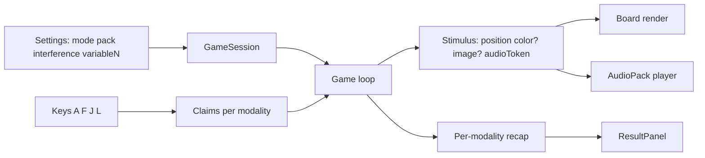

# feat: Brain Workshop modes — interference, variable N, tri/quad, piano

## Goal Capsule

Ship Brain Workshop–aligned training modes in this React dual n-back trainer: interference-biased stimulus generation, variable N per trial, triple/quad modality sessions (position + color + SVG image + audio), and a selectable piano audio pack — with one match key per active modality.

Authority: this plan; behavioral prior art is [brain-workshop/brainworkshop](https://github.com/brain-workshop/brainworkshop) (`brainworkshop.py` + `Readme-instructions.txt`). Existing dual-mode ISI / center-cell settings stay.

Stop when Definition of Done is met. Do not add crab-back, combination cross-modal matching, arithmetic, multi-stimulus, or pentuple+.

---

## Product Contract

### Summary

Extend the trainer from fixed dual n-back (position + letter audio) to selectable Dual / Triple / Quad modes, BW-style interference chance, optional variable N, SVG image + color visual channels, and letters-or-piano audio packs, using BW-style per-modality keys.

### Problem Frame

Advanced trainees outgrow dual-only practice. Brain Workshop already defines the training vocabulary (interference near-misses, variable N, tri/quad channels, piano set). This app should expose those modes without becoming a full BW port.

### Requirements

- R1. Session mode selector: Dual, Triple, Quad, with fixed modality sets (below).
- R2. Dual = position + audio (parity with today’s game).
- R3. Triple = position + color + audio.
- R4. Quad = position + color + image + audio.
- R5. Color channel uses a small discrete palette (BW-like distinct hues); one color per trial; match = same color N trials ago.
- R6. Image channel uses a curated set of random SVG pictures (not photos); one glyph per trial; match = same glyph N trials ago.
- R7. Audio pack is selectable: `letters` (current) or `piano` (C-scale style notes); pack chooses which sounds play, not which key claims audio match.
- R8. Interference: configurable chance in BW style (default ~0.125; options like 0, 1/8 … 1, plus default). When triggered on a modality with `level > 1`, prefer a near-miss lag of N−1, N+1, or 2N (when history allows) instead of a true N-back copy; if no valid near-miss exists, fall back to non-interference random/match logic.
- R9. Variable N (toggle): before the session, sample a per-trial lag sequence (BW: beta distribution bounded by session level); each trial shows current N; match validation uses that trial’s N.
- R10. Input is BW-style: one claim key per active modality. Defaults: Position `A`, Color `F`, Image `J`, Audio `L` (match BW ascii defaults). Only keys for modalities in the active mode are live.
- R11. Results report per-modality scores for every modality that was active in the session.
- R12. Existing settings remain: level, trials, ISI range, allow-center-stimulus, theme chrome.

### Actors

- A1. Trainee — configures mode/settings, runs session, claims matches per modality.
- A2. Implementer / agent — executes units against this plan.

### Key Flows

- F1. Idle configure → pick Dual/Tri/Quad, audio pack, interference chance, variable-N on/off → Space start.
- F2. Trial onset → board shows position (+ color/image as applicable) and plays audio pack sound → trainee may press each active modality key once → after ISI, score claims vs true N-back (or variable N) → next trial.
- F3. Session end → result panel lists each active modality’s hit/miss / %.

### Acceptance Examples

- AE1. Dual + letters + interference 0 behaves like today’s dual game (keys A/L).
- AE2. Quad session: four keys live; color fills the lit cell; SVG glyph visible in that cell; piano pack plays note instead of letter; results show four rows.
- AE3. Interference mid: with chance 1.0 and N≥2, many trials are near-misses (match N±1 or 2N history, not N) for at least one modality — claiming N-back on those is incorrect.
- AE4. Variable N on: on-screen N changes across trials; a claim is scored against the N shown for that trial, not the session level alone.

### Scope Boundaries

**In scope:** modality registry; Dual/Tri/Quad; color + SVG image; interference chance; variable N; piano pack; per-modality keys/UI/results; tests for generation/validation/keys.

**Deferred to Follow-Up Work:** crab-back; combination modes; arithmetic; multi-stimulus; pentuple / sound2; Jaeggi auto level progression; persistence of settings across reloads; touch/on-screen modality buttons beyond current notice pattern.

**Outside this product's identity:** full Brain Workshop feature parity, clinical Jaeggi UI clone, stereo dual-audio.

### Product Contract preservation

Product Contract authored in this bootstrap from user confirmation (2026-07-27): color + random SVG; piano selectable pack; BW-style interference chance; BW-style per-modality input. Product Contract unchanged after planning enrichment.

---

## Planning Contract

### Context basis

- Local dual engine: `src/model/Game.ts`, `src/store/GameSession.ts`, `src/store/gameStore.ts`.
- Settings pattern to mirror: ISI + `allowCenterStimulus` (store → `Game`/`GameDeps` → SettingsPanel).
- UI: `src/components/Board/`, `SettingsPanel/`, `UserMatchNotice`, `useKeyboardControls.ts`, `ResultPanel/`.
- Prior art (cloned for research): Brain Workshop `brainworkshop.py` — mode modality tables (~1210–1228), interference near-miss (~4287–4299), variable N beta list (~4089–4093, scoring ~3319), keys (~580–591), piano under `res/sounds/piano/`, sprites under `res/sprites/polygons-basic/`.
- RepoPrompt unavailable this session; discovery via Cursor Grep/Read + BW checkout.

### Key Technical Decisions

- KTD1. Modality-first registry — (session-settled: user-directed — chosen over keeping hardcoded dual flags): introduce a small modality id set (`position`, `color`, `image`, `audio`) with key binding, stimulus field, and scorer entry; Dual/Tri/Quad are mode presets that select an ordered subset. Chosen over proliferating parallel Game subclasses.
- KTD2. Mode presets fixed — Dual = position+audio; Triple = position+color+audio; Quad = position+color+image+audio. Chosen over free-form modality mixers for v1 (BW has many mode ids; we expose three).
- KTD3. Interference = BW chance + near-miss lags — (session-settled: user-directed — chosen over simple on/off): settings `interferenceChance` with BW-like steps (0 … 1 by eighths, default 0.125). Eligibility gate uses session level (`level > 1`), matching BW `mode.back > 1` — not the per-trial variable lag. Near-miss offsets `{−1, +1, level}` apply to the effective back used for that trial (after variable-N adjustment when enabled); drop `−1` when session level < 3. Historical value must differ from the true N-back value. Chosen over inventing a new trick model.
- KTD4. Variable N = BW list length/indexing — (session-settled: user-directed): when enabled, precompute a beta-sampled lag list of length `trials - level` (BW `makeVariableList` shape), not `trials`. Display/validate using BW-equivalent indexing against that list (effective lag for trial `t` is looked up relative to session level / list offset — implementer mirrors BW `variable_list` + `computeNBackIndex` semantics, not a naive `variableNs[t]` of length `trials`). Session “level” remains the difficulty ceiling / beta parameter.
- KTD5. Visual stimulus composition — color tints the active board cell; SVG glyph renders inside the active cell (or centered overlay when color also active). Dual mode keeps today’s highlight-only look (no forced color/image).
- KTD6. Audio packs — (session-settled: user-directed — chosen over piano-only): `Speech` (or successor) resolves sound URLs from pack id + stimulus token; piano tokens are note names (C4…); letter tokens stay current letters. Pack is orthogonal to mode.
- KTD7. Input model BW-style — (session-settled: user-directed): one claim per modality per trial; keys A/F/J/L for position/color/image/audio; generalize `Match` / store `btns` / `UserMatchNotice` to active modalities only.
- KTD8. SVG assets — ship a small first-party SVG set under `public/assets/images/` (inspired by BW polygon set, not a binary dump of BW PNGs unless license review is done in-unit). Prefer inline or static SVG files with stable ids.
- KTD9. Piano assets — Brain Workshop is GPL-2; prefer first-party or permissively licensed C-scale samples under `public/assets/sounds/piano/` rather than vendoring BW WAVs into this app unless the project intentionally accepts GPL obligations. Document source in README.
- KTD10. Scoring — generalize `GameHistory` / `GameResult` / `ResultPanel` to a map/list of modalities present in the session (not four hard-coded fields forever). Dual results remain readable.

### Assumptions

- BW GPL/license allows either redistributing piano WAVs with attribution or forces replacement — implementer verifies LICENSE.md during U4 and picks the allowed path.
- “Random SVG picture” means uniform sample from a fixed curated set each trial (not generative AI images).
- Generator moves to BW-style per-modality rolls (guaranteed-match chance + interference chance). AE1 means dual UX/scoring/key parity with interference 0, not bit-identical RNG sequences vs today’s coupled thresholds — capture today’s scoring rules with characterization tests before the rewrite.
- Introduce an explicit `guaranteedMatchChance` (BW default 0.125) injectable via `GameDeps` for tests; dual playability at interference 0 is the product bar.
- Canonical modality id is `audio` (not `sound`); U1 renames history/result fields with a thin adapter only if needed for a single release.
- Touch/click modality buttons are nice-to-have; keyboard is required for AE coverage.

### High-Level Technical Design



Stimulus generation (directional):

```text
for each active modality M:
  roll r1, r2
  if r1 < guaranteedMatchChance → copy value from trial - N*
  else if r2 < interferenceChance and N* > 1 → try near-miss lag in {N*-1, N*+1, 2N*} …
  else → random value in M's alphabet
where N* = BW-effective lag for this trial if variableN else sessionLevel
```

### Scope Boundaries (implementation)

- Do not rewrite the React stack or remove ISI / center-cell settings.
- Do not port BW’s full mode id matrix, crab, combination, or multi-stim.
- Prefer extending `Game` over a second parallel engine.

### Open Questions

- Q1 (deferred): Persist settings (mode/pack/interference) to `localStorage` — follow-up.
- Q2 (deferred): On-screen clickable modality buttons for mobile — follow-up.
- Q3 (deferred): Jaeggi-style auto advance/fallback on session score — follow-up.

### Risks & Dependencies

- Risk: Domain type rewrite (U1) breaks dual parity if adapters linger — mitigate with AE1 characterization tests before changing generators.
- Risk: Piano asset licensing blocks vendoring — mitigate with KTD9 fallback (generate equivalent notes) before U5 lands.
- Risk: Interference + variable N interaction is easy to get wrong on indexing — mitigate with seeded tests covering both flags together in U3.
- Dependency: Howler + static files under `public/assets/` (existing pattern).
- Dependency: Brain Workshop semantics as behavioral oracle, not a runtime dependency.

### System-Wide Impact

- Trainee-facing: new settings density; four-key muscle memory; denser board (color+glyph).
- Developer-facing: `Game` becomes the multimodal hub; UI must stay thin over modality registry.
- No persistence/API/CI contract changes beyond README and static assets.

---

## Implementation Units

### U1. Modality registry and generalized domain types

**Goal:** Replace dual-only types with a modality registry and mode presets so the rest of the stack can be modality-agnostic.

**Requirements:** R1–R4, R10–R11 (type foundation)

**Dependencies:** none

**Files:**
- create: `src/model/modalities.ts` (ids, presets Dual/Tri/Quad, default keys, stimulus alphabets stubs)
- modify: `src/model/types.ts`, `src/model/Match.ts`, `src/model/enums/userInput.ts` (or replace with modality id), `src/model/GameHistory.ts`, `src/model/GameResult.ts`
- test: `src/model/modalities.test.ts`, extend `src/model/GameResult.test.ts`

**Approach:** Define `ModalityId`, `ModeId`, `MODE_PRESETS`, `DEFAULT_KEYS`. `BoardState` becomes position + optional `colorId` / `imageId` / `audioToken` + `currentTrials` (+ optional `nForTrial` for U3). `Match` / history / results store claims and recaps keyed by modality. Keep dual presets behaving as today.

**Patterns to follow:** Narrow pure modules like `src/model/isi.ts`; avoid UI imports in model.

**Test scenarios:**
- Dual preset lists exactly position+audio.
- Triple/Quad presets match R3/R4.
- GameResult with three modalities averages / exposes per-modality % correctly (including zero-attempt modality → 0%).

**Verification:** Unit tests green; TypeScript compiles with updated call sites stubbed or updated in-unit as needed (prefer finishing call-site updates in U2/U5 if compile requires temporary adapters — avoid long-lived shims).

---

### U2. Stimulus generation: multi-modality + interference

**Goal:** Generalize `Game` generation/validation across active modalities and add BW-style interference chance.

**Requirements:** R5–R6 (generation side), R8, R12

**Dependencies:** U1

**Files:**
- modify: `src/model/Game.ts`, `src/model/types.ts` (`GameDeps`), `src/store/GameSession.ts`, `src/store/gameStore.ts`
- test: extend `src/model/Game.test.ts`

**Approach:** Pass `mode` / active modalities + `interferenceChance` (+ injectable `guaranteedMatchChance`) into `Game`. Per modality, BW-style two-roll generation (KTD3). Validate each claimed modality independently against lag N (fixed until U3). Preserve ISI sampling and early-trial “no history ⇒ claim fails” behavior. Before replacing generators, add characterization tests for dual scoring/claim rules (AE1).

**Execution note:** Implement interference and multi-modality generation test-first in `Game.test.ts` with a seeded `random`.

**Patterns to follow:** Existing `getRandomPosition` / center exclusion; ISI injection via constructor; `Game.test.ts` fake timers.

**Test scenarios:**
- Happy path: Dual + interference 0 + seeded random still produces valid position/audio and scores a true N-back claim success.
- Interference: with `interferenceChance = 1`, `guaranteedMatchChance = 0`, N=3, forced RNG — at least one modality copies a near-miss history value ≠ true N-back value; claiming N-back fails.
- Miss semantics: keep today’s rule — a modality is scored when the player claims it and/or a true match existed (characterize in tests before rewrite; do not invent a new withhold model).
- Edge: session level 2 interference omits lag −1 (BW `back < 3`).
- Edge: `allowCenterStimulus: false` never yields position 4 under multi-modality generation.
- Integration: `GameSession` construction reads new settings and starts without throw.

**Verification:** Targeted `Game` tests pass; dual smoke via store test still starts.

---

### U3. Variable N-back

**Goal:** Optional per-trial N sequence with on-screen N and validation against that N.

**Requirements:** R9, AE4

**Dependencies:** U2

**Files:**
- modify: `src/model/Game.ts`, `src/store/gameStore.ts`, `src/store/GameSession.ts`, `src/App.tsx` or board overlay for N display, `src/components/SettingsPanel/index.tsx`
- test: extend `src/model/Game.test.ts`

**Approach:** When `variableN` enabled, precompute BW-shaped lag list (`trials - level`, beta sampling — KTD4); expose effective N on each `BoardState` for HUD + validation. HUD shows current N during play (in addition to level/trials chrome). When disabled, behavior identical to fixed level.

**Patterns to follow:** Session status chrome in `App.tsx`; settings toggles like center-cell.

**Test scenarios:**
- Happy path: fixed list injected via deps → trial k validates against BW-equivalent effective lag for that trial.
- Combined: variable N on + interference on (seeded) — near-miss offsets use effective lag; eligibility still requires session level > 1.
- Edge: early trials with insufficient history still treat claims as failed.
- Edge: toggle off → uses session level only.
- UI: in-memory Zustand settings (not localStorage) apply to the next `startGame` snapshot.

**Verification:** Unit tests for lag indexing; manual/visual check that N label updates (note in verification, not a unit requirement).

---

### U4. Color + SVG image rendering and assets

**Goal:** Render color and SVG image stimuli on the board for Tri/Quad.

**Requirements:** R5, R6, AE2

**Dependencies:** U1 (types), U2 (live stimuli in store) — rendering can be stubbed with mocked board state after U1, but Tri/Quad end-to-end needs U2.

**Files:**
- create: `public/assets/images/*.svg` (curated set), `src/model/imageSet.ts`, `src/model/colorSet.ts`
- modify: `src/components/Board/BoardSquare.tsx`, `src/components/Board/Board.scss`, `src/components/Board/index.tsx`
- test: `src/model/imageSet.test.ts` (ids stable, count ≥ 6); optional component smoke if harness already supports RTL

**Approach:** Define 6–8 high-contrast colors and 6–8 SVG glyphs. Active cell shows color fill when color modality active; glyph overlays when image modality active. Dual mode: keep current highlight styling (position-only). Respect `DESIGN.md` radius/spacing; no decorative gradient blobs.

**Patterns to follow:** Existing highlight opacity transition; theme CSS variables for chrome (stimulus colors are task colors, not theme primary).

**Test scenarios:**
- Image/color alphabets have unique ids and non-empty lists.
- Test expectation for pure styling: none beyond alphabet unit tests — visual check Dual vs Quad in browser during U6.

**Verification:** Quad session visually shows tint + glyph on the active square only.

---

### U5. Selectable audio packs (letters | piano)

**Goal:** Let settings choose letters vs piano; playback resolves the correct files.

**Requirements:** R7, KTD6, KTD9

**Dependencies:** U1 (audio token abstraction)

**Files:**
- create: `public/assets/sounds/piano/*` (vendored or generated), `src/model/audioPacks.ts`
- modify: `src/model/Speech.ts`, `src/store/GameSession.ts`, `src/store/gameStore.ts`, `src/components/SettingsPanel/index.tsx`, `README.md` (asset/license note)
- test: extend `src/model/Speech.test.ts`; `src/model/audioPacks.test.ts`

**Approach:** `audioPack: 'letters' | 'piano'`. Stimulus stores a pack-agnostic token index or symbol; Speech maps pack+token → URL under `BASE_URL`. Piano alphabet size should match letters count (8) for drop-in generation, or define its own length used only when pack is piano — prefer equal cardinality for simpler RNG. Verify BW license before copying WAVs.

**Patterns to follow:** Current `Speech` Howler map; letter file naming.

**Test scenarios:**
- Letters pack URL still ends with `/assets/sounds/letters/c.wav` (or current convention).
- Piano pack URL points under `/assets/sounds/piano/`.
- Unknown token does not throw (existing Speech behavior).

**Verification:** Manual listen once per pack; unit URL tests green.

---

### U6. Settings, keyboard, match chrome, results

**Goal:** Wire mode / interference / variable N / audio pack into UI and BW-style multi-key input + results.

**Requirements:** R1, R8–R12, AE1–AE2

**Dependencies:** U2, U3, U4, U5

**Files:**
- modify: `src/components/SettingsPanel/index.tsx`, `SettingsPanel.scss`, `src/hooks/useKeyboardControls.ts`, `src/hooks/useKeyboardControls.test.tsx`, `src/components/utils/UserMatchNotice.tsx`, `src/components/utils/ActionButton.tsx`, `src/components/ResultPanel/index.tsx`, `src/store/gameStore.ts`, `src/store/GameSession.ts` (`selectModality`, board sync for color/image/audioToken, multi-btn feedback), `src/App.tsx` (hints if needed), `README.md`
- test: extend keyboard + store tests; add settings→session snapshot test in `src/store/gameStore.test.ts`

**Approach:** Settings rows for Mode, Audio pack, Interference (cycler/select of BW fractions), Variable N toggle. Keyboard dispatches `selectModality(id)` for active set only; treat keys case-insensitively (`a`/`A`). `GameSession` syncs full stimulus fields into Zustand for Board. Match notice renders one control per active modality with keycap labels. Results table maps modalities dynamically; aggregate % stays attempt-weighted across modalities (current `generalMatchPercentage` rule generalized).

**Patterns to follow:** Center-cell toggle row; live `getState()` in keyboard hook; session settings snapshot at `GameSession` construct.

**Test scenarios:**
- Happy path: Quad mode → keys F and J invoke color/image claims (store spies).
- Edge: Dual mode → F/J do nothing.
- Edge: interference setting and mode are snapshotted at start (changing settings mid-run does not mutate active `Game`).
- Integration: startGame with Triple + piano does not throw; boardState carries color id.

**Verification:** `pnpm test` + `pnpm build`; README documents modes and keys.

---

## Verification Contract

- `pnpm test` — all unit/hook tests green, including new modality / interference / variable-N / pack URL cases.
- `pnpm build` — typecheck + production build clean.
- Manual smoke (implementer): Dual letters baseline; Quad + piano + interference ~0.25 + variable N on for one short session; confirm keys A/F/J/L and result rows.

## Definition of Done

- R1–R12 and AE1–AE4 satisfied or explicitly deferred with user approval.
- U1–U6 complete with listed tests.
- README updated for modes, keys, packs, interference, variable N.
- No crab/combination/arithmetic/multi-stim shipped.
- Piano asset licensing path documented.

## Sources & Research

- Brain Workshop upstream: https://github.com/brain-workshop/brainworkshop — `Readme-instructions.txt` (mode glossary), `brainworkshop.py` (modality tables, interference, variable N, keys, assets).
- Local architecture brief (this session): dual `Game` / `GameSession` / Zustand shell; gaps enumerated for multimodal generalization.
- External generic “best practices” research skipped — BW source is the load-bearing prior art.
- Prefer function anchors in BW (`makeVariableList`, interference block in stimulus generation, key constants) over brittle line numbers.
- `docs/solutions/` absent; no institutional learnings to fold in.
)