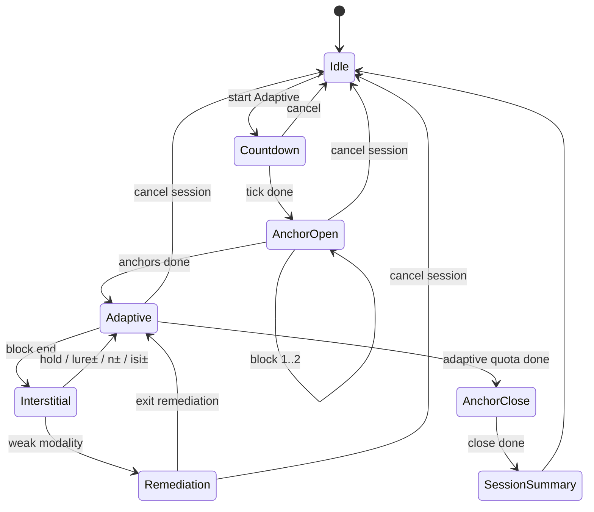

# feat: Adaptive d′ progression with stratified lures

## Goal Capsule

Ship an Adaptive training path beside free-play that progresses memory load and interference using per-modality stratified d′ (clean / lure / all) and criterion — not raw accuracy — with temporal n±1 lures, five lure stages per n, rolling three-block evidence, median-plus-floor gating, two-window promotion hysteresis, opening/closing anchors, weak-modality remediation, post-mastery ISI tightening, and persisted ladder state.

Authority: this plan; product model from the user SDT/progression brief (2026-07-27). Free-play Dual/Tri/Quad + manual interference remain unchanged for trainees who opt out of Adaptive.

Stop when Definition of Done is met. Do not claim IQ / far-transfer benefits. Do not ship Bayesian ability surfaces, perceptual-similarity lures, or continuously varying difficulty in this plan.

---

## Product Contract

### Summary

Add Adaptive training that scores full signal-detection outcomes per modality, stages lure difficulty before raising n, adapts one dimension at a time from a rolling evidence window, and persists the trainee’s ladder across browser visits — while free-play keeps today’s manual controls.

### Problem Frame

Match-percentage scoring hides liberal responders and cannot separate sequence-updating skill from lure rejection. The single `interferenceChance` knob and manual level arrows do not encode a scientifically coherent ladder. Trainees need a mode that adapts n and interference precisely without collapsing those dimensions into one pooled score.

### Requirements

- R1. Training path selector: Free-play (today’s controls) vs Adaptive (ladder-driven).
- R2. Adaptive records per-modality hit / miss / false alarm / correct rejection on every scorable trial (after warmup `t < N`).
- R3. Compute per-modality d′ and criterion c with loglinear correction: `H'=(hits+0.5)/(targets+1)`, `FA'=(FA+0.5)/(non-targets+1)`, `d'=Z(H')-Z(FA')`, `c=-(Z(H')+Z(FA'))/2`.
- R4. Stratify non-targets into clean vs temporal lure; report d′_clean, d′_lure, d′_all, lure cost (FA_lure − FA_clean), and criterion.
- R5. Temporal lures are items matching history at n−1 or n+1 (not true n); Adaptive uses five lure-density/proximity stages within each n (2A…2E style), then raises n and partially resets lure stage.
- R6. Progression uses rolling ~3 adaptive blocks: promote lure stage when median d′_clean ≳ 2.0, every modality d′_clean ≳ 1.4, criterion not extreme, lure d′ stable; require two consecutive promotion windows. Raise n only after top lure stage mastery with d′_all / d′_lure thresholds from the brief; after n↑ reduce lure stage by 1–2. Demote lure first when clean OK but lure collapses; demote n when both poor across two windows.
- R7. Aggregates for gating: median modality d′, minimum modality d′, spread (diagnostic). One primary difficulty change per decision.
- R8. Session structure: two standardised opening calibration blocks → ~6–12 adaptive blocks → one closing anchor. Anchors use fixed condition and are excluded from the rolling promotion window.
- R9. Weak-modality remediation: when one modality is below the floor while others are adequate, insert a short single/dual remediation block for that stream, then return to Adaptive; do not always drag every dimension to the weakest.
- R10. After discrimination mastery at a condition, optionally tighten ISI one tier while holding n and lure stage; revert if d′ collapses.
- R11. Persist Adaptive ladder state across visits (localStorage); free-play settings remain independent.
- R12. Cross-modal match/lure quotas are optional (off by default); when on, generate Adaptive blocks from quotas then validate.
- R13. Immediate post-block UI shows hits, FAs, block d′ (all + clean/lure), lure errors, and (when available) median correct RT; progression estimate remains window-based.
- R14. Free-play keeps manual level, trials, interference chance, variable N, ISI; Adaptive locks variable N off and drives n / lure stage / ISI tier from the ladder.
- R15. Product claim language: “adapts memory load and interference control more precisely” — never “proven to improve general intelligence.”

### Actors

- A1. Trainee — chooses Free-play or Adaptive, runs sessions, reviews block metrics.
- A2. Implementer / agent — executes units against this plan.

### Key Flows

- F1. Idle → select Adaptive + mode (Dual/Tri/Quad) → Space → opening anchors → adaptive blocks with interstitial results → closing anchor → session summary.
- F2. Block end → SDT metrics → controller consults rolling window → hold / lure± / n± / remediation / ISI± → next block config.
- F3. Weak shape (example) → keep n → reduce shape lure or insert shape remediation → resume Adaptive when floor cleared.
- F4. Free-play path unchanged: manual settings → single block → match-% results (may also show d′ if ledger available, but no ladder mutation).
- F5. Reload browser → Adaptive ladder restores; in-progress session is abandoned (not resumed).

### Acceptance Examples

- AE1. Adaptive Dual: after a block with genuine matches and clean non-targets, miss and CR appear in counts; d′ is finite even with perfect hits (loglinear).
- AE2. Lure stage C+ produces tagged n±1 lure trials; claiming match on a lure is FA_lure; d′_lure drops relative to d′_clean when the trainee is lure-sensitive.
- AE3. Two consecutive promotion windows at stage E with d′_all mastery → n increases and lure stage resets down; free-play level setting is untouched.
- AE4. One modality below floor with others strong → remediation block inserted; median alone does not promote.
- AE5. Reload after Adaptive session → same n / lure stage / ISI tier restore; Free-play interference setting unchanged.
- AE6. Optional quotas off: generation uses stage densities without cross-modal quota enforcement; on: block satisfies configured match-count quotas within tolerance.

### Scope Boundaries

**In scope:** SDT ledger + stratified d′/c; Adaptive path beside free-play; five lure stages; rolling controller; anchors; remediation; ISI tighten/revert; ladder persistence; optional quotas; results/settings UI; tests.

**Deferred to Follow-Up Work:** Bayesian ability estimation; perceptual-similarity lures; continuous difficulty; personalised lure types; joint ability surface across n/timing/modality; automated optimisation of target/lure density; mid-session resume after reload; touch-only Adaptive controls.

**Outside this product's identity:** clinical Jaeggi clone; IQ / far-transfer marketing claims; full Brain Workshop port.

### Product Contract preservation

Product Contract authored in this bootstrap from the user SDT brief and scoping answers (2026-07-27): Adaptive beside free-play; remediation + ISI in v1; persist ladder; quotas optional. Product Contract unchanged after planning enrichment.

---

## Planning Contract

### Context basis

- Scoring today: `src/model/Game.ts` `validateChoice` only records when `matched || claimed` — **CR omitted** (misses recorded as failed; no target/clean/lure stratification — blocker for d′).
- Near-miss generation exists (`tryNearMiss`) but trials are not tagged for SDT strata.
- Session: `src/store/gameStore.ts` + `src/store/GameSession.ts` — single-block lifecycle; `pushGameResult` unused (GameSession inlines).
- Persistence: none (prior plan 002 deferred localStorage).
- Results UI: `src/components/ResultPanel/`; settings: `src/components/SettingsPanel/`.
- Prior plan: `docs/plans/2026-07-27-002-feat-brainworkshop-modes-plan.md` deferred “Jaeggi auto level progression” (Q3) — this plan is that follow-up, with d′ ladder instead of crude accuracy.
- RepoPrompt unavailable this session; discovery via Cursor Grep/Read + research subagents.
- Stack: React 19.1, Zustand 5.0.6, Vitest 3.2.4.

### Key Technical Decisions

- KTD1. Adaptive beside free-play — (session-settled: user-directed — chosen over replacing manual advancement): `playMode: 'free' | 'adaptive'`; free-play keeps level/interference/variableN; Adaptive owns ladder-driven n, lure stage, ISI tier.
- KTD2. Full SDT ledger before percentages — rewrite scoring so every scorable trial (`t >= effectiveN`) emits hit|miss|FA|CR per modality; retain match-% as a derived view for free-play compatibility. Characterization tests lock dual free-play behaviour at interference 0 before Adaptive-only paths diverge.
- KTD3. Stratified d′ — (session-settled: user-directed — chosen over single pooled d′): compute clean / lure / all per modality with loglinear correction; gate on median + minimum; never promote n solely from pooled accuracy.
- KTD4. Five lure stages map to density + proximity — Adaptive generation uses the stage schedule below (not free-play `interferenceChance`). Free-play keeps the existing chance knob.

  | Stage | Deliberate lure rate | Proximity set |
  | ----- | -------------------: | ------------- |
  | A | ~0% | none |
  | B | ~10% | distant (prefer lag ≫ n, e.g. 2n when history allows) |
  | C | ~10% | near n±1 only |
  | D | ~20% | mixed distant + n±1 |
  | E | ~30% | near-weighted mix of n−1 and n+1 |

  Drop n−1 candidates when session n < 3. Rates are targets for the generator, not guarantees after collision repair.
- KTD5. Rolling controller with hysteresis — (session-settled: user-directed): evidence window = last 3 **adaptive** blocks (anchors and remediation excluded from promote windows; remediation has its own exit rule). Two consecutive promotion windows required; demotion also needs repeated evidence unless collapse is extreme (both clean and lure floors failed).
- KTD6. Ladder persisted per mode — (session-settled: user-directed — chosen over session-only): versioned localStorage schema keyed by `ModeId` (`n`, `lureStage` A–E, `isiTier`, optional remediation hints). Corrupt/missing → defaults; reload abandons in-progress Adaptive session.
- KTD7. Remediation + ISI in v1 — (session-settled: user-directed — chosen over deferring both):
  - **Remediation recipe:** when exactly one modality is below the d′ floor while median remains adequate, insert one block at current n, lure stage max(A, current−1), modalities = {weak} + position if weak ≠ position else {weak, audio} (always at least dual-or-single practice on the weak stream). Max one remediation insert per modality per session; exit after that block (do not require a second promotion window). Remediation blocks are excluded from the 3-block promote window.
  - **ISI tiers:** discrete steps on the shared min/max pair, e.g. tier index mapping to clamped ranges around defaults (illustrative: 3000/3000 → 2500/2500 → 2000/2000 → 1500/1500 ms, always through `clampIsiMs`). Tighten one tier only after discrimination mastery at current n+lure; revert one tier if the next adaptive window’s median d′_all falls below the promote floor.
- KTD8. Cross-modal quotas optional — (session-settled: user-directed — chosen over always-on quotas): settings flag default off; when on, Adaptive block builder applies quotas then validates accidental matches/lures.
- KTD9. Pure domain modules — put `sdtMetrics`, `lureStages`, `adaptiveController`, `ladderPersistence` under `src/model/` (framework-free); orchestrate from store/session. Prefer pure functions + Vitest over store-heavy logic.
- KTD10. Consolidate post-block path — Adaptive orchestration must go through one end-of-block handler (fix or wrap `GameSession.onGameEnded` / `pushGameResult`) so free-play and Adaptive do not diverge silently.
- KTD11. Thresholds are tunable constants — start with brief heuristics (median clean ≥ 2.0, floor ≥ 1.4, lure ≥ 1.2–1.5, criterion |c| extreme band); expose as named constants, not magic numbers scattered in UI.
- KTD12. Early / sparse data → Hold — if a stratum lacks minimum targets/non-targets (or window < 3 adaptive blocks), controller Holds; never promote on noisy single-block jumps.

### High-Level Technical Design

#### Adaptive session state machine



#### Controller decision (one primary dimension)

```text
After each adaptive evidence window (when canDecide):
  if core load failure (clean poor across modalities)
      → decrease n (or Hold if at floor) ; reset lure partially
  else if lure-specific failure (clean OK, lure poor)
      → decrease lure stage (or Hold at A)
  else if single weak modality
      → remediation insert (does not change n/lure for others)
  else if extreme criterion only
      → Hold + feedback hint (no dimension change)
  else if top lure mastered + d′_all / d′_lure OK (2 windows)
      → increase n ; lure stage -= 1..2
  else if clean mastery + lure stable (2 windows)
      → increase lure stage
  else if discrimination mastered + speed eligible
      → tighten ISI tier
  else
      → Hold
```

#### Metrics data flow

```text
Game.generate → tag trialRole{modality: target|clean|lure(lag)}
     → validate → SDT cell per modality
     → BlockSdtReport (per modality clean/lure/all + c + RT)
     → results.all (tagged blockRole)
     → AdaptiveController(window) → LadderDelta
     → next GameSession deps snapshot
     → ladderPersistence.save
```

### Assumptions

- Default Adaptive session length: 2 open anchors + 8 adaptive blocks + 1 close (within 6–12 adaptive band); constants adjustable.
- Ladder starts at n=2, lure stage A, default ISI tier matching current isi defaults.
- Warmup trials `t < effectiveN` excluded from SDT denominators (claims still may show as failed for UX feedback if desired, but do not enter d′).
- Cancel mid-block discards that block (excluded from window); completed blocks in the session remain for persistence of ladder decisions already applied.
- Anchor blocks use the trainee’s current ladder n with lure stage A (or fixed calibration stage) and current ISI tier; they never alone promote.
- Free-play may display d′ when the ledger exists, but never mutates the Adaptive ladder.
- Optional quotas default off; exact quota table can be refined in implementation as long as AE6 holds.

### Implementation Constraints

- Preserve free-play Dual/Tri/Quad, interference cycler, variable N, piano/letters, countdown, layout-stable chrome.
- No new npm dependencies for erf/Z — implement inverse-normal via a small well-tested helper (or document a tiny local approximation); keep MIT-compatible.
- Do not edit via RepoPrompt; Cursor owns writes.
- Honest copy only (R15).

### Sequencing

U1 (SDT metrics) → U2 (lure stages/tags) → U3 (ladder persistence + playMode) → U4 (controller) → U5 (session FSM) → U6 (UI) → U7 (optional quotas). U7 may ship behind the flag after U2 generation hooks exist; must not block U4–U6 if quotas remain off.

---

## Implementation Units

### U1. Trial-level SDT ledger and stratified d′ / criterion

**Goal:** Every scorable trial contributes hit/miss/FA/CR per modality; pure functions compute loglinear d′ and c for clean / lure / all.

**Requirements:** R2, R3, R4, R13 (metric inputs)

**Dependencies:** None

**Files:**
- Create: `src/model/sdtMetrics.ts` (exports `BlockSdtReport` and per-modality SDT types), `src/model/sdtMetrics.test.ts`
- Modify: `src/model/Game.ts`, `src/model/GameHistory.ts`, `src/model/GameResult.ts`, `src/model/Game.test.ts`, `src/model/GameResult.test.ts`
- Optional types: `src/model/types.ts`

**Approach:**
- Extend history with per-trial, per-modality outcomes including non-response cases.
- Tag trial strata when lure metadata is present (U2); until then, treat all non-targets as clean so d′_all works.
- Implement `zApprox` + `dPrime` / `criterion` with loglinear correction; unit-test known tables (perfect, chance, liberal bias).
- `GameResult` exposes SDT summaries alongside existing percentages.

**Execution note:** Characterization-first on free-play interference 0 dual scoring before changing `validateChoice` semantics for misses/CRs.

**Patterns to follow:** Pure domain helpers like `src/model/isi.ts`; existing `GameResult` percentage tests.

**Test scenarios:**
- Happy: target+claim → hit; target+no claim → miss; non-target+claim → FA; non-target+no claim → CR.
- Edge: zero targets / zero FAs → finite d′ via loglinear; `t < N` excluded from denominators.
- Edge: perfect hits and zero FAs → high but finite d′.
- Edge: non-target + no claim → CR recorded (not skipped by `matched || claimed`).
- Integration: dual free-play block still reports match-% consistent with prior definition where only scored trials existed — document any intentional % change if CR/miss inclusion alters denominators (prefer: % remains attempts-on-decision trials; SDT is additive).

**Verification:** `sdtMetrics` tests green; `Game` / `GameResult` tests updated; free-play dual smoke still passes.

---

### U2. Adaptive lure stages and trial tagging

**Goal:** Map five lure stages to generation policy; tag each modality stimulus as target / clean / lure(lag) for stratified metrics.

**Requirements:** R5, R4

**Dependencies:** U1

**Files:**
- Create: `src/model/lureStages.ts`, `src/model/lureStages.test.ts`
- Modify: `src/model/Game.ts`, `src/model/types.ts` / `GameDeps`, `src/model/Game.test.ts`, `src/store/GameSession.ts` (pass stage when Adaptive)

**Approach:**
- Define stage enum/table (A–E) with target lure density and proximity set (distant vs n±1).
- Adaptive path supplies `lureStage` in deps; free-play continues to use `interferenceChance`.
- `tryNearMiss` / generator records intended role; validate accidental true matches after lure placement.
- Prefer n−1 / n+1 for near stages; drop n−1 when n < 3 (same eligibility spirit as current level gate).

**Patterns to follow:** Existing `tryNearMiss` + injected `random` in `Game.test.ts`.

**Test scenarios:**
- Happy: stage E with seeded RNG produces tagged n±1 lures at roughly configured density.
- Edge: stage A produces ~0 deliberate lures; accidental repeats still tagged if they happen.
- Edge: n=2 omits n−1 lure candidates.
- Integration: FA on tagged lure increments lure FA cell used by d′_lure.

**Verification:** Seeded generation tests; stratified d′ differs when lure FAs concentrate on lure trials.

---

### U3. Play mode fork and ladder persistence

**Goal:** Free-play vs Adaptive setting; versioned localStorage ladder per `ModeId`.

**Requirements:** R1, R11, R14

**Dependencies:** None (can parallel U1/U2; must land before U5)

**Files:**
- Create: `src/model/ladderPersistence.ts`, `src/model/ladderPersistence.test.ts`
- Modify: `src/store/gameStore.ts`, `src/store/gameStore.test.ts`

**Approach:**
- Schema v1: `{ version: 1, byMode: { dual|triple|quad: { n, lureStage, isiTier } } }`.
- Load on store init; save after controller applies a ladder delta.
- `playMode` in settings; switching only when idle (not countdown/in-session).
- Defaults: n=2, lureStage=A, isiTier=default.

**Patterns to follow:** Zustand settings mutations; clamp helpers from `isi.ts`.

**Test scenarios:**
- Happy: save → reload mock localStorage → same ladder.
- Error: corrupt JSON → defaults, no throw.
- Edge: unknown version → defaults.
- Edge: switch playMode during session rejected / no-op.

**Verification:** Persistence unit tests; store tests for playMode guards.

---

### U4. Adaptive progression controller

**Goal:** Pure controller turns a rolling window of block SDT reports into at most one primary ladder delta (or remediation / ISI action).

**Requirements:** R6, R7, R9, R10

**Dependencies:** U1, U2 (for lure strata), U3 (ladder types)

**Files:**
- Create: `src/model/adaptiveController.ts`, `src/model/adaptiveController.test.ts`

**Approach:**
- Inputs: last 3 adaptive `BlockSdtReport`s, current ladder, optional prior window verdict for hysteresis.
- Outputs: `{ action: hold|lureUp|lureDown|nUp|nDown|remediate|isiTighten|isiRevert, modality?: ModalityId, reason }`.
- Encode threshold constants in one place; `canDecide` false → Hold.
- Pattern table from brief (clean good/lure poor → lure down; etc.).

**Execution note:** Implement test-first with synthetic block reports (no Game needed).

**Test scenarios:**
- Happy: two windows above promote → lureUp then eventually nUp with lure reset.
- Happy: clean good, lure poor → lureDown / Hold (not nUp).
- Happy: one weak modality → remediate that modality.
- Edge: window size < 3 → Hold.
- Edge: extreme liberal criterion → Hold (no promote).
- Edge: after nUp, lure stage decreased by 1–2.
- Edge: ISI tighten only when discrimination mastered; isiRevert when post-tighten d′ collapses.

**Verification:** Controller tests cover promote/demote/remediate/hold matrix without UI.

---

### U5. Adaptive session orchestrator

**Goal:** Multi-block Adaptive session: anchors → adaptive loop → remediation inserts → closing anchor; one end-of-block pipeline.

**Requirements:** R8, R9, R10, F1–F3, F5

**Dependencies:** U3, U4, U2

**Files:**
- Create: `src/store/adaptiveSession.ts` (or equivalent orchestrator module), `src/store/adaptiveSession.test.ts`
- Modify: `src/store/gameStore.ts`, `src/store/GameSession.ts`, `src/store/gameStore.test.ts`, `src/hooks/useKeyboardControls.ts`

**Approach:**
- Session FSM phases; each block constructs `GameSession` with snapshot deps from ladder + phase.
- Interstitial: keep `results.last` as block report; Space continues (or auto-advance after short delay — prefer explicit Space to match current UX).
- Cancel session: discard incomplete block; persist only deltas already applied; return idle.
- Tag results with `blockRole`: `anchor-open|adaptive|remediation|anchor-close|free`.
- Adaptive locks `variableN=false`; ignores free-play interference cycler.

**Patterns to follow:** Countdown → `launchSession` in `gameStore`; settings snapshot in `GameSession` constructor.

**Test scenarios:**
- Happy: start Adaptive → 2 anchors excluded from window → adaptive blocks feed controller.
- Happy: remediation insert then resume adaptive index.
- Edge: cancel during anchor → idle, ladder unchanged if no adaptive decisions yet.
- Edge: cancel mid adaptive block → block discarded from window.
- Integration: free-play start still single-block; does not read Adaptive phase machine.
- Integration: post-block path uses shared handler (no double-push).

**Verification:** Store/orchestrator tests with fake timers; free-play regression tests green.

---

### U6. Results and settings UI for Adaptive + SDT

**Goal:** Trainee can select Adaptive, see ladder/condition, and read stratified metrics after each block.

**Requirements:** R1, R13, R14, R15, AE1–AE5

**Dependencies:** U1, U3, U4, U5

**Files:**
- Modify: `src/components/SettingsPanel/index.tsx`, `SettingsPanel.scss`
- Modify: `src/components/ResultPanel/index.tsx`, `ResultPanel.scss`
- Modify: `src/App.tsx`, `App.scss` (session status: n · mode · lure stage · timing)
- Modify: `src/components/Footer/` or keyboard hints if Adaptive continue affordance differs
- Tests: extend store/keyboard tests; optional light component tests if pattern exists

**Approach:**
- Settings: Free-play / Adaptive toggle; when Adaptive, hide or disable manual level/interference/variableN; show read-only ladder summary; optional quotas checkbox (wired in U7).
- Results: per-modality d′ clean/lure/all, c, hits/FAs/misses; lure errors; short next-step hint from last controller action.
- Copy: no IQ claims.
- Preserve layout-stable chrome rules from recent work (absolute overlays; no crosshair jump).

**Patterns to follow:** Existing ResultPanel modality grid; SettingsPanel toggles.

**Test scenarios:**
- Happy: Adaptive idle shows locked manual difficulty controls.
- Happy: results render finite d′ values from a fixture `GameResult`.
- Edge: free-play still shows match-% rows; Adaptive shows SDT emphasis.
- Integration: keyboard Space continues Adaptive interstitial without starting a nested free-play game.

**Verification:** Manual UI check + store/keyboard tests; build succeeds.

---

### U7. Optional cross-modal quotas

**Goal:** When enabled, Adaptive blocks are built from match/lure quotas across modalities, then validated.

**Requirements:** R12, AE6

**Dependencies:** U2, U5

**Files:**
- Create: `src/model/blockQuotas.ts`, `src/model/blockQuotas.test.ts`
- Modify: `Game` Adaptive generation path or precompute stimulus plan; SettingsPanel checkbox; `GameDeps` flag

**Approach:**
- Default off — random/stage density path remains.
- When on: allocate counts for 0..M simultaneous targets, lure+target mixes; regenerate/repair accidental true matches; balance per-modality target counts within tolerance.
- Keep v1 quotas modest (documented table in module); do not block Adaptive shipping if flag stays off.

**Test scenarios:**
- Happy: quotas on → each modality target count within tolerance for a seeded plan.
- Happy: quotas off → no quota planner invocation.
- Edge: impossible quota request fails soft to best-effort + warning in dev assert, not blank board.

**Verification:** Quota unit tests; Adaptive session still runs with flag off (default).

---

## Verification Contract

- Unit: `npm test` (Vitest) — must include new `sdtMetrics`, `lureStages`, `adaptiveController`, `ladderPersistence`, orchestrator, and quota tests.
- Focused regression: existing `Game.test.ts`, `gameStore.test.ts`, `GameResult.test.ts`, keyboard tests remain green for free-play.
- Typecheck/build: `npm run build`.
- Manual smoke: Free-play dual block unchanged feel; Adaptive short session (anchors + 2 adaptive with shortened trial counts in a debug constant if needed) shows d′ and a Hold/lure decision; reload restores ladder; cancel mid-block returns idle without crash.

---

## Definition of Done

- All units U1–U7 complete or U7 explicitly shippable as flag-off with tests proving default path.
- R1–R15 satisfied; AE1–AE6 covered by automated and/or documented manual checks.
- Free-play Dual/Tri/Quad + interference + variable N + countdown + chrome stability preserved.
- Ladder persists across reload; Adaptive does not mutate free-play interference/level settings.
- No IQ / far-transfer claims in UI copy.
- Abandoned experiment code removed from the diff.
- README notes Adaptive mode and persistence key at a high level (no marketing overclaim).

---

## Risks & Dependencies

| Risk | Mitigation |
|------|------------|
| Miss/CR rewrite changes free-play % meaning | Characterization tests; keep % definition explicit; SDT additive |
| Noisy d′ on short blocks | Min-sample Hold; 3-block window; two-window promote |
| Lure tagging vs accidental matches | Validate after generation; tests for mis-tags |
| Controller thrash | Hysteresis; one dimension per decision |
| localStorage unavailable | In-memory fallback; no crash |
| Quotas complexity | Optional, default off; isolate in U7 |
| Prior plan deferred auto-level | This plan supersedes that deferral for Adaptive only |

---

## Open Questions

None blocking. Deferred (non-blocking): exact Adaptive interstitial auto-advance vs Space-only; fine-tuning threshold constants after real play; whether free-play results panel always shows d′ or only in Adaptive.

---

## Sources & Research

- User SDT / progression brief (2026-07-27) — load-bearing for formulas, ladder shape, controller branching, v1 scope.
- Local: `src/model/Game.ts`, `GameResult.ts`, `GameHistory.ts`, `gameStore.ts`, `GameSession.ts`, `ResultPanel/`, `SettingsPanel/`.
- Prior plan: `docs/plans/2026-07-27-002-feat-brainworkshop-modes-plan.md` (interference/near-miss prior art; deferred Jaeggi Q3).
- Institutional `docs/solutions/`: none present.
- External web research this run: skipped — brief already supplied citations and formulas; implementation-guidance drawn from that text + local patterns.
- Cited prior art in brief (APA d′, Hautus loglinear correction, lure/interference literature) informs KTDs but is not re-fetched here.
