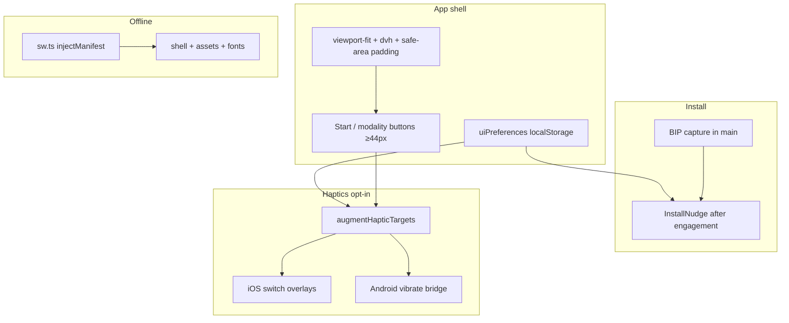

# feat: iPhone-fit PWA with offline play and haptics

## Goal Capsule

Ship Dual N-Back as an installable, iPhone-Safari-and-Home-Screen-ready PWA: correct safe areas and shell height, tappable ≥44px gameplay controls, full offline play after one online visit, Chromium + iOS install UX, and opt-in dual-platform haptics — without Web Push and without changing Adaptive/free-play game rules.

Authority: this plan; iPhone PWA skill (`iphone-pwa` patterns/haptics/reference) as platform guidance; confirmed scope (full offline, install nudge, haptics in).

Stop when Definition of Done is met. Do not claim IQ benefits. Do not ship push notifications.

---

## Product Contract

### Summary

Harden the existing Vite/React trainer for iPhone tab + standalone use: viewport/safe areas, touch-playable match and start controls, web app manifest + Apple meta/icons, service-worker precache of shell and game assets (including self-hosted fonts), deferred install nudge, and opt-in haptics that work on iOS via switch overlays and on Android via vibrate/`browser-haptic`.

### Problem Frame

The app is desktop-first: `100vh` shell, no safe-area padding, tiny hit targets, keyboard-only match claims, Google Fonts CDN dependency, and no manifest/SW. On an iPhone it feels broken and cannot be trained on without a keyboard. Trainees need a Home Screen–quality loop that works offline after one visit.

### Requirements

- R1. Viewport uses `width=device-width, initial-scale=1, viewport-fit=cover` and allows zoom (no `user-scalable=no`).
- R2. App shell height uses `100dvh` with `100vh` fallback; chrome padding is `max(token, env(safe-area-inset-*))` for top/right/bottom/left.
- R3. Primary interactive controls expose ≥44×44 CSS px hit regions (gear, close, steps, toggles, segments, theme, match claim, start/continue). ISI range thumbs keep a ≥44px hit area even if the visible knob stays smaller.
- R4. During a session (and countdown/interstitial as needed), each active modality has an on-screen control that calls `selectModality`; idle/interstitial exposes Start/Continue that call `startGame` — keyboard shortcuts remain.
- R5. `touch-action: manipulation` on buttons/cards; no mouse-only handlers for play actions.
- R6. Web app manifest (`name`, `short_name`, `start_url`, `scope`, `display: standalone`, theme/background colors, 192 + 512 icons) plus Apple meta (`apple-mobile-web-app-capable`, title, status-bar-style) and `apple-touch-icon` (180).
- R7. After one online visit, a full free-play or Adaptive block is playable offline: app shell, letter + piano sounds, poly images, and IBM Plex (self-hosted — not Google Fonts CDN).
- R8. Service worker updates must not force reload mid-session; apply waiting worker only when idle (no game, no countdown, no Adaptive `pendingContinue`).
- R9. Install nudge after light engagement (≥1 completed block or ≥2 visits), snoozed ~7 days on dismiss, hidden when standalone; Chromium uses deferred `beforeinstallprompt`, iOS Safari shows Add to Home Screen steps.
- R10. Opt-in haptic feedback (default **off**), persisted; iOS uses real `<input type="checkbox" switch>` overlays (17.4+); Android uses capture bridge + `browser-haptic` / vibrate; never `navigator.vibrate`-only; never gate on `prefers-reduced-motion`.
- R11. Haptics re-augment after settings open/close and other UI revisions that remount controls.
- R12. No Web Push in this plan.
- R13. Support floor: iOS 14+ for install/offline shell; iOS haptics documented as 17.4+ System Haptics.
- R14. Product copy must not imply IQ gains (existing description meta should stay non-claim or be softened if touched).

### Actors

- A1. Trainee on iPhone Safari tab or Home Screen standalone.
- A2. Trainee on Chromium desktop/Android (secondary install path).
- A3. Implementer / agent executing units.

### Key Flows

- F1. First visit online → assets + SW install → later offline launch still runs a full block.
- F2. Idle → Start (tap or Space) → countdown → trials with on-screen modality taps → results → Continue (Adaptive) or idle.
- F3. After engagement → install nudge (iOS instructions or Chromium prompt) → dismiss snoozes; standalone never shows nudge.
- F4. Settings → enable Haptic feedback → taps on match/settings controls pulse per platform rules.
- F5. New deploy while idle → waiting SW applied safely; mid-session update waits until idle.

### Acceptance Examples

- AE1. On a notched iPhone simulator/device, gear, footer, Adaptive HUD, and match bar clear the status bar and home indicator (no clipped controls).
- AE2. With no hardware keyboard, trainee can start a dual block and claim position + audio matches via on-screen controls; scoring behaves as keyboard claims.
- AE3. After one online load, airplane mode + Home Screen (or SW-controlled tab) still plays letter/piano audio and shows poly images for a full block.
- AE4. Standalone mode: no install banner. Non-standalone after engagement: iOS sees Share → Add to Home Screen copy; Chromium can one-tap install when BIP captured.
- AE5. Haptics off by default; when on, Android match tap vibrates; iOS match tap Taptics via switch overlay on device (not simulator-proof). Enabling toggle does not request notification permission.
- AE6. While a block is running, a waiting service worker does not reload the page; returning to idle applies the update.

### Scope Boundaries

**In scope:** Viewport/safe areas/dvh; ≥44px targets; tappable start + modality claims; manifest + Apple meta + icons; self-host fonts; `vite-plugin-pwa` + custom SW precache; install nudge; opt-in dual-platform haptics; README/QA notes; unit tests for prefs/install eligibility/haptic gating; build verification.

**Deferred to Follow-Up Work:** Web Push / training reminders; persisting all free-play settings (beyond new UI prefs); landscape-specific redesign; iPad multitasking polish; maskable icon marketing set beyond practical 192/512/180; continuous drag haptics (N/A — discrete taps only).

**Outside this product's identity:** Native App Store binary; Background Sync; IQ/far-transfer claims; forcing haptics on by default.

---

## Planning Contract

### Key Technical Decisions

- KTD1. Use `vite-plugin-pwa` with `strategies: 'injectManifest'` and `src/sw.ts` — (session-settled: user-approved — chosen over generateSW-only: need denylist/nav fallback and safe update control per iPhone PWA patterns).
- KTD2. Full offline play means precache `public/assets/**` game media + built shell + self-hosted IBM Plex — (session-settled: user-directed — chosen over shell-only offline).
- KTD3. Install nudge in v1 after engagement — (session-settled: user-directed — chosen over meta-only).
- KTD4. Opt-in dual-platform haptics in this plan — (session-settled: user-directed — chosen over deferring haptics).
- KTD5. On-screen modality + Start/Continue controls are in scope because keyboard-only gameplay fails the iPhone-fit goal (inferred from confirmed “full playable” + iPhone PWA skill; no alternate play surface exists today).
- KTD6. Persist new prefs (`hapticFeedbackEnabled`, install dismiss/visit counters) via a small `localStorage` module mirroring `src/model/ladderPersistence.ts` (versioned JSON, silent fail); do not persist entire free-play settings in this plan.
- KTD7. Capture `beforeinstallprompt` in `main.tsx` bootstrap (page lifetime), not only inside a mounted banner — per iPhone PWA patterns.
- KTD8. SW update: prompt/`updateSW` only when `game == null && countdown == null && !adaptiveSession?.pendingContinue`.
- KTD9. Prefer `@fontsource/ibm-plex-sans` (or local `public/fonts`) over Google Fonts CDN so offline text does not blank.
- KTD10. Haptics: mount/augment pattern from `iphone-pwa/haptics.md` (`data-haptic`, iOS switch overlays, Android capture bridge); add `browser-haptic` dependency for Android helpers; no global vibrate polyfills.

### High-Level Technical Design

### Assumptions

- HTTPS hosting (or localhost) is available for SW/install testing.
- Piano assets under `public/assets/sounds/piano/` are already licensed for bundling (NOTICE present); plan does not re-litigate audio licensing.
- Theme preference may remain session-only unless cheap to fold into `uiPreferences` while touching App — optional stretch, not required.

### Risks & Dependencies

| Risk | Mitigation |
|------|------------|
| Howler + SW caching of audio | Precache URLs matching `getSoundSrc` / BASE_URL; smoke offline audio |
| Mid-session SW reload | Idle-only `skipWaiting` / `updateSW` |
| iOS Taptic only on device / 17.4+ | Settings hint copy; never claim simulator proof |
| Google Fonts offline blanking | Self-host before claiming R7 |
| Match UI crowding Adaptive HUD | Stack match bar above home-indicator padding; keep HUD clear of buttons |
| `cursor: none` while playing | Keep pointer events on match buttons; do not disable taps |
| `useFullScreen` / `requestFullscreen` in `GameSession` | Leave default off; do not auto-request fullscreen in standalone iOS (conflicts / no-ops) — revisit only if a settings toggle is added later |

### Sources & Research

- Local: Vite 6.4 / React 19.2 app; no SW/manifest today; ladder-only localStorage; keyboard-only claims (`useKeyboardControls`, display-only `ActionButton`).
- Institutional: `docs/solutions/` — none for PWA/mobile.
- External / skill: `iphone-pwa` skill (patterns, haptics, reference); `vite-plugin-pwa` injectManifest for Vite 6.

---

## Implementation Units

### U1. Viewport, safe areas, and shell height

**Goal:** iPhone chrome no longer clips under notch / home indicator; shell uses dynamic viewport height.

**Requirements:** R1, R2, AE1

**Dependencies:** None

**Files:**
- Modify: `index.html`, `src/App.scss`, `src/components/Topbar/Topbar.scss`, `src/components/Footer/Footer.scss`, `src/components/SettingsPanel/SettingsPanel.scss`, `src/components/AdaptiveProgressHud/AdaptiveProgressHud.scss`, `src/components/VariableNHud/VariableNHud.scss`, `src/components/utils/UserMatchNotice.scss`, `src/components/Board/Board.scss`, `DESIGN.md`

**Approach:** Add `viewport-fit=cover`. Replace bare `100vh` with `100dvh` fallback chain. Define shared CSS vars for frame padding that `max()` with safe-area insets; apply to absolute chrome insets (topbar/footer/HUDs/match bar/settings panel). Keep playing-mode layout-stable (visibility hide, not unmount).

**Patterns to follow:** Existing absolute chrome in `App.scss`; DESIGN.md pad-frame tokens.

**Test scenarios:**
- Happy path: document that computed padding uses safe-area when env non-zero (unit or CSS snapshot optional).
- Test expectation: none required beyond visual/device smoke if no existing CSS test harness — prefer a small pure helper if padding tokens are computed in JS; otherwise Verification smoke AE1.

**Verification:** Notched layout smoke (simulator or device); no control under home indicator.

---

### U2. Touch play surface — Start/Continue + modality claims

**Goal:** Trainee can complete a dual block on iPhone without a keyboard.

**Requirements:** R3, R4, R5, AE2

**Dependencies:** U1 (safe bottom inset for match bar)

**Files:**
- Modify: `src/components/utils/ActionButton.tsx`, `src/components/utils/UserMatchNotice.scss`, `src/components/Board/index.tsx`, `src/components/Footer/index.tsx`, `src/components/ResultPanel/index.tsx`, `src/components/Topbar/Topbar.scss`, `src/components/SettingsPanel/SettingsPanel.scss`, `src/components/Footer/Footer.scss`
- Test: `src/components/utils/ActionButton.test.tsx` (new) and/or extend store/keyboard tests for tap path

**Approach:** Turn modality notices into real `<button type="button">` (≥44px) calling `selectModality`. Add Start/Continue buttons for idle and Adaptive interstitial (Space remains). Enlarge settings/theme/ISI-thumb hit targets to ≥44px (visible knob/icon can stay smaller). `touch-action: manipulation` on interactive controls. Keep keyboard path in `useKeyboardControls` unchanged. Do not enable fullscreen auto-request for standalone iOS.

**Patterns to follow:** `selectModality` / `startGame` from store; existing button feedback classes on match notices.

**Execution note:** Prefer a failing interaction test that click on modality button invokes `selectModality` while a session is active.

**Test scenarios:**
- Happy path: active session + click position button → `selectModality('position')` called.
- Happy path: idle + click Start → countdown begins.
- Edge: modality buttons absent or disabled when `game == null` (except Start).
- Integration: keyboard A/L still works alongside buttons.

**Verification:** Dual block completable via taps only in browser device mode.

---

### U3. Manifest, Apple meta, and icons

**Goal:** Installable standalone identity on iOS and Chromium.

**Requirements:** R6, R13

**Dependencies:** None (can parallel U1/U2)

**Files:**
- Create: `public/manifest.webmanifest`, `public/icons/icon-192.png`, `public/icons/icon-512.png`, `public/apple-touch-icon.png` (or generated via assets pipeline)
- Modify: `index.html`, `vite.config.ts` (manifest link if plugin-managed), `README.md`

**Approach:** Ship both standard manifest and Apple fallbacks. Theme color aligned with current `#2c2e31` (or design token). Icons: simple mark consistent with brand mark in topbar. Prefer generating PNGs once and committing under `public/`.

**Patterns to follow:** iPhone PWA HTML install head example; existing `theme-color` in `index.html`.

**Test scenarios:**
- Happy path: manifest JSON has required fields (`display: standalone`, icons 192/512, `start_url`/`scope`).
- Test: `src/pwa/manifest.test.ts` or build-time assertion reading `public/manifest.webmanifest`.

**Verification:** Lighthouse installability or manual Add to Home Screen uses icon/title.

---

### U4. Self-host fonts + offline SW precache

**Goal:** Full playable offline after one online visit; safe SW updates.

**Requirements:** R7, R8, AE3, AE6

**Dependencies:** U3 (manifest wiring often co-located in VitePWA)

**Files:**
- Create: `src/sw.ts`, `src/pwa/registerSW.ts` (or equivalent), font import path
- Modify: `vite.config.ts`, `package.json`, `index.html` (remove Google Fonts CDN), `src/main.tsx`, `src/App.tsx` (idle-gated update apply)
- Test: `src/pwa/updateGate.test.ts` (new)

**Approach:** Add `vite-plugin-pwa` + workbox deps; `injectManifest` with navigation fallback to shell and denylist for non-HTML. Precache build output + `public/assets` sounds/images + font files. Register SW from bootstrap. `shouldApplyWaitingUpdate` true only when idle. Soften meta description if editing `index.html` for R14.

**Patterns to follow:** iPhone PWA patterns (nav denylist, safe update); Howler URLs from `audioPacks.ts` / `BASE_URL`.

**Execution note:** Smoke-first after build (`vite build` + preview offline) in addition to unit tests for the idle gate.

**Test scenarios:**
- Happy path: `shouldApplyWaitingUpdate` true when idle; false when `game` set, countdown set, or `pendingContinue`.
- Edge: Adaptive interstitial blocks update apply.
- Integration/smoke: preview build with SW; disable network; start game; audio token request served from cache (manual or Playwright if present — manual OK).

**Verification:** Airplane-mode block completes with audio; mid-game deploy does not wipe session.

---

### U5. Install nudge (Chromium BIP + iOS A2HS)

**Goal:** Engaged users can install; standalone users never nagged.

**Requirements:** R9, AE4

**Dependencies:** U3, U4 (SW/manifest improve installability)

**Files:**
- Create: `src/pwa/installPrompt.ts`, `src/pwa/installEligibility.ts`, `src/model/uiPreferences.ts`, `src/components/InstallNudge/index.tsx` (+ scss)
- Modify: `src/main.tsx`, `src/App.tsx`, `src/store/gameStore.ts` or App-level wiring to bump visit/completion counts on block end
- Test: `src/pwa/installEligibility.test.ts`

**Approach:** Page-lifetime BIP capture. Eligibility: not standalone; engaged (≥1 result pushed or visitCount≥2); dismiss snooze 7 days; show if iOS Safari **or** deferred BIP present. iOS UI: instructional steps. Chromium: `prompt()` on deferred event. Persist prefs via `uiPreferences` schema v1.

**Patterns to follow:** iPhone PWA `shouldShowInstallNudge` / BIP stash; `ladderPersistence` silent localStorage.

**Test scenarios:**
- Happy path: engaged + iOS flag → show; standalone → hide.
- Happy path: dismiss sets `dismissedAt`; within 7 days → hide.
- Edge: no BIP and not iOS → hide.
- Edge: visitCount 1 and zero completions → hide.

**Verification:** Manual iOS Safari A2HS path; Chromium install when criteria met.

---

### U6. Opt-in dual-platform haptics

**Goal:** Tappable controls can pulse on iOS and Android when enabled; default off.

**Requirements:** R10, R11, AE5

**Dependencies:** U2 (real buttons to augment), U5 prefs module (or share `uiPreferences`)

**Files:**
- Create: `src/haptics/haptics.ts`, `src/haptics/hapticOverlay.ts`, `src/haptics/hapticTargets.ts`, `src/haptics/Haptics.scss`
- Modify: `src/components/SettingsPanel/index.tsx`, `src/App.tsx` (install bridges + augment), `package.json` (`browser-haptic`), `src/model/uiPreferences.ts`
- Test: `src/haptics/haptics.test.ts` (platform gating / no-op when disabled)

**Approach:** Default `hapticFeedbackEnabled: false`. Settings toggle with iOS System Haptics hint. On enable path: augment match buttons, Start, settings controls with `data-haptic`; iOS overlays; Android capture bridge. Re-augment when settings panel opens/closes and when modality set changes. Programmatic success cues Android-only; iOS no-op outside gesture. Do not gate on `prefers-reduced-motion`.

**Patterns to follow:** `iphone-pwa/haptics.md` architecture table and anti-patterns list.

**Execution note:** Unit-test enable/disable and “disabled → fireKind no-op”; device QA for Taptic.

**Test scenarios:**
- Happy path: disabled → `fireKind` / play helpers no-op.
- Happy path: enabled + Android path → vibrate/bridge invoked (mocked).
- Edge: iOS programmatic `playHaptic('success')` no-op.
- Edge: `prefers-reduced-motion` does not force disable when setting on.

**Verification:** Settings copy present; device smoke on iPhone 17.4+ and Android.

---

### U7. README + PWA QA notes

**Goal:** Document install, offline, haptics limits, and verification commands.

**Requirements:** R12, R13, R14 (docs surface)

**Dependencies:** U3–U6

**Files:**
- Modify: `README.md`
- Create (optional): `docs/pwa-qa.md` only if README would bloat — prefer README section first

**Approach:** Document Home Screen install (iOS + Chromium), offline expectation, haptics opt-in + iOS 17.4/System Haptics, no push, support floor. List `pnpm build` / preview offline smoke.

**Test expectation:** none — docs only.

**Verification:** README section exists and matches shipped behavior.

---

## Verification Contract

- Unit: `pnpm test` (or `npm test`) — eligibility, update gate, haptics gating, modality button wiring, manifest fields.
- Build: `pnpm build` succeeds with VitePWA generate.
- Smoke: `pnpm preview` — offline full block; idle SW update; installability checks.
- Device QA matrix (manual): Safari tab + Home Screen standalone on iOS 15.4+ and current iOS; notch/home indicator; haptics on physical iPhone when opted in; Chromium Android/desktop BIP smoke.

## Definition of Done

- All U1–U7 complete with listed tests/smoke.
- AE1–AE6 satisfied or explicitly waived with user sign-off for device-only items (AE5 Taptic).
- No Web Push code paths.
- README documents install/offline/haptics.
- Playing a dual block on iPhone without a keyboard is possible end-to-end.

---

## Open Questions

- Deferred: Whether to persist theme in `uiPreferences` while touching App (nice-to-have).
- Deferred: Whether Start button is always visible on desktop or only when coarse pointer / touch — default: always show compact Start for parity; keyboard Space remains.
