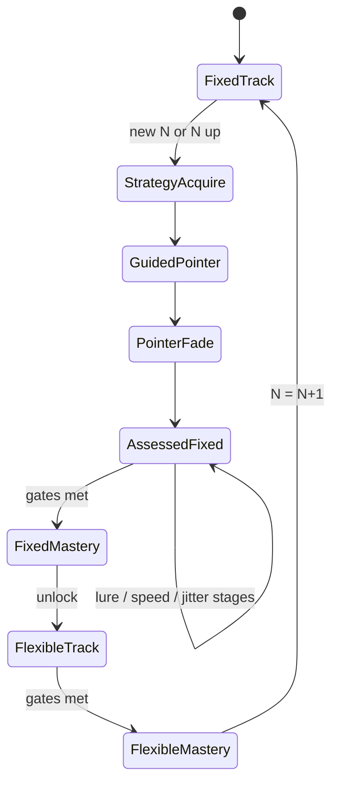

# Adaptive cyclic updating curriculum - Plan

## Goal Capsule

Replace Adaptive’s Match-% ladder (which embeds variable N inside every n-cycle) with a dual-track curriculum that **teaches fixed-N cyclic one-slot updating**, verifies a lure-sensitive mechanism signature, automates under speed/jitter, then unlocks a **separate flexible-lag track**.

Authority: this plan; product shape from the 2026-08-03 Adaptive redesign brief and session decisions; reuse SDT/lure infrastructure from `docs/plans/2026-07-27-003-feat-adaptive-dprime-progression-plan.md` where it already exists. This plan **supersedes** both the shipped Match-% recipe in `docs/adaptive-mode.md` and the unshipped d′ session orchestrator from plan 003 for Adaptive progression.

Stop when Definition of Done is met. Do not claim IQ or far-transfer benefits. Do not ship pointer-resumption diagnostics, cross-wrapper transfer curricula, anchors/remediation session structure, or Bayesian ability surfaces in this plan.

---

## Product Contract

### Summary

Adaptive becomes a strategy-first dual track: at each newly introduced N, teach compare→replace→advance with a visible slot pointer (memory contents hidden), fade scaffolding, train lure discrimination and speed on **fixed N**, run a mastery test, then enter a **flexible-lag** track that reuses variable-N sampling. Promotion uses stratified d′ / lure false-alarm gates, not Match % alone.

### Problem Frame

Shipped Adaptive promotes on Match % ≥ 80% and treats speed + in-cycle variable N as anti-rehearsal levers (`docs/adaptive-mode.md`). Research on efficient N-back performance points instead to **cyclic one-slot updating** (retrieve active slot → compare → respond → overwrite → advance). Explicit instruction in that strategy can produce large, rapid N-back gains; variable lag before the circular buffer is learned trains a harder retrieval skill and muddies the routine. Match % also fails to catch liberal responders and lure-blind familiarity strategies. Far transfer remains a later research bet; this ship optimizes for a **mechanism signature** (lure rejection, stable cyclic operation, no major modality collapse).

### Requirements

- R1. Keep Free-play vs Adaptive path selector; Free-play retains manual level / interference / variable N / ISI.
- R2. At every newly introduced session N on the fixed track, run a mandatory **strategy-acquisition** sequence before ordinary assessed blocks: explicit instruction copy, then guided blocks with visible slot pointer and operation labels (COMPARE / REPLACE / NEXT). Memory slot contents stay hidden.
- R3. Teach the operation as compare → replace → advance (one shared temporal pointer across modalities), not full-list shift/rehearsal.
- R4. Fixed-N track per N uses a curriculum stage ladder (pointer → fade → no pointer → lure build-up → speed → jitter → mastery). Variable N stays **off** for the entire fixed track.
- R5. Wire Adaptive generation to existing lure stages A–E (`src/model/lureStages.ts`) instead of recipe `interferenceChance` for assessed fixed-N stages that require lures.
- R6. Promotion / demotion / hold for assessed blocks use lure-sensitive SDT gates (median + floor d′_clean, lure FA / d′_lure, no major modality collapse), never Match % alone. Guided / instruction / fade blocks are **not** promotion evidence.
- R7. Introduce faster ISI and mild ISI jitter only after lure-stable fixed-N operation at a comfortable pace.
- R8. After fixed-N mastery at N, unlock the **flexible-lag track** at that N (variable N on; progressive speed/jitter). Completing flexible-lag mastery raises N and restarts the fixed track at N+1 (with a fresh strategy-acquisition phase).
- R9. Persist dual-track ladder state per mode across visits (localStorage + existing cloud progress sync path); Free-play settings remain independent. Schema bump is a clean break from Match-% v2 indices.
- R10. Results / interstitial UI surfaces target hits, ordinary FAs, lure FAs, per-modality sensitivity, RT when available, and the curriculum/track stage — not Match-% as the sole progression story.
- R11. Product claim language: teaches and verifies cyclic updating under load — never “proven general intelligence / far transfer.”
- R12. Open one-block Adaptive loop with interstitials remains (no fixed 2+8+1 anchor session in this plan).

### Actors

- A1. Trainee — chooses Adaptive + mode, follows strategy instruction, runs curriculum blocks, continues via interstitial.
- A2. Implementer / agent — executes units against this plan.

### Key Flows

- F1. Idle → Adaptive + mode → first block at current N shows strategy instruction → guided pointer blocks → fade → assessed fixed-N stages → interstitial after each assessed block with gate feedback.
- F2. Assessed block end → SDT report → curriculum controller promote/hold/demote one stage (or hold for sparse data) → persist ladder → continue.
- F3. Fixed-N mastery at N → enter flexible-lag track at N → assessed flexible blocks with variable N → mastery → N↑ → fixed track restarts with strategy-acquisition at N+1.
- F4. Free-play unchanged.
- F5. Reload → ladder restores; in-progress Adaptive session abandoned (same as today).

### Acceptance Examples

- AE1. New Dual Adaptive at N=2: trainee sees explicit “compare, replace, next” instruction; guided block shows slot pointer cycling 1→2→… without revealing stored letters/positions; Match % alone does not advance the curriculum.
- AE2. During fixed-N lure stages, Adaptive sets `lureStage` on generation; claiming match on an n±1 lure counts as lure FA and blocks promotion when lure FA exceeds threshold even if overall Match % is high.
- AE3. Variable N remains false through fixed-N mastery; after mastery, next assessed block has variable N true and HUD can show effective lag (existing VariableNHud pattern).
- AE4. Faster ISI / jitter stages are unreachable until lure-stable promotion at the comfortable-pace stages.
- AE5. Reload after progress → same track, N, curriculum stage, lure stage, ISI tier restore; Free-play knobs untouched.
- AE6. Product copy / docs never claim far-transfer or IQ gains.

### Key Decisions

- KD1. Full dual-track Adaptive (fixed-N cyclic + flexible-lag) — (session-settled: user-directed — chosen over fixed-N-only with lag as a deferred handoff): both tracks fully specified in this plan. Governs R4, R8.
- KD2. Mechanism-bet success — (session-settled: user-approved — chosen over far-transfer-or-bust and honest-near-win-only framing): ship judged by lure-sensitive cyclic signature; far transfer is aspirational, not a claim. Governs R6, R11.
- KD3. Full curriculum, not an MVP slice — (session-settled: user-directed — chosen over smallest teach-and-verify change): strategy acquisition through mastery and flexible-lag are in scope. Governs R2–R8.
- KD4. Explicit strategy instruction + visible pointer scaffolding — (directive, one planning challenge: accepted — research shows instruction accelerates one-update learning; anti-strategy ISI-only approach is the status quo being replaced). Governs R2, R3.
- KD5. Variable N is a later skill family, not an in-cycle difficulty step — (session-settled: user-directed — chosen over keeping variable N inside every n-cycle). Governs R4, R8.
- KD6. Diagnostics suite (pointer-resumption, post-error probe blocks) and cross-wrapper transfer — out of this plan (user chose areas 1+3 only). Soft signals that fit existing SDT ledgers (lure FA, modality floors) remain in R6.

### Scope Boundaries

**In scope:** Dual-track curriculum model; strategy instruction + slot-pointer HUD; session/FSM wiring; SDT/lure-sensitive controller replacing Match-% `decideProgression`; persistence schema v3 + sync; Adaptive UI/docs updates; tests.

**Deferred to Follow-Up Work:** Pointer-resumption / slot-repair diagnostic probes; post-error recovery probe blocks as first-class stages; cross-wrapper transfer curriculum; plan 003 anchors + weak-modality remediation inserts; rolling multi-block hysteresis beyond the minimum needed for sparse-data Hold; Bayesian ability; mid-session resume after reload.

**Outside this product's identity:** IQ / far-transfer marketing; clinical Jaeggi clone; full Brain Workshop port.

### Assumptions

- A-ass1. Tunable gate constants start from plan 003 heuristics (median d′_clean ≳ 2.0, floor ≳ 1.4, lure d′ ≳ 1.2–1.5, extreme criterion Hold) unless implementation discovers they are unusable on short blocks — then adjust constants only, not the gate structure.
- A-ass2. Flexible-lag track after fixed mastery is automatic (no trainee choice UI between “next N” vs “flexible”); completing flexible mastery always advances N.
- A-ass3. Strategy-acquisition (instruction + guided + fade) runs once per newly introduced N on the fixed track, including after N↑; not every return from interstitial.
- A-ass4. Open one-block loop stays; plan 003’s fixed session quota / anchors are not revived here.
- A-ass5. Ladder v3 migration resets Match-% v2 progress (same clean-break precedent as v1→v2).

---

## Planning Contract

### Context basis

- Shipped progression: `src/model/adaptiveLevels.ts` Match-% ≥ 80% / 3-fail demote; steps 6–9 enable `variableN`.
- Session: `src/store/adaptiveSession.ts` open loop; `processAdaptiveBlockEnd` takes `matchPct` only.
- SDT + lure stages exist (`src/model/sdtMetrics.ts`, `src/model/lureStages.ts`) and Results already render them; Adaptive **strips** `lureStage` when applying ladder settings today.
- `src/model/adaptiveController.ts` is a deprecated re-export of Match-% `decideProgression`.
- Persistence: `src/model/ladderPersistence.ts` schema v2 `{ levelIndex, failStreak }` per mode; cloud via `progressDocument.ts` / `progressSync.ts`.
- No slot-pointer / strategy-instruction footprint in repo.
- Prior plan 003 (~half implemented) supplies SDT/lure patterns to revive for gates; this plan replaces its Adaptive product shape for progression.
- RepoPrompt unavailable this session; research via Cursor + subagents. External strategy evidence from user-attached research reports (Malinovitch one-update; Laine strategy instruction; Soveri meta-analysis — strong near transfer, weak far transfer).
- Stack: React 19, Zustand, Vitest (`npm test` / `vitest run`).

### Product Contract preservation

Product Contract authored in this bootstrap from the 2026-08-03 cyclic-updating brief and session-settled scope answers. No prior requirements-only unified plan existed.

### Key Technical Decisions

- KTD1. Supersede Match-% recipe with a curriculum state machine — (session-settled product KD1/KD3): replace `STEP_RECIPES` + `levelIndex` progression with explicit `{ track, n, curriculumStage, lureStage, isiTier }` (names directional). Keep `adaptiveLevels.ts` only if demoted to helpers (ISI tier mapping / clamps); do not leave two live promote paths.
- KTD2. Revive Adaptive `lureStage` wiring — stop stripping `lureStage` in `gameStore` Adaptive apply path; assessed lure stages drive `GameDeps.lureStage` and set `interferenceChance` secondary/ignored for Adaptive generation when stage is set (follow existing `Game.ts` lureStage branch).
- KTD3. Rewrite `adaptiveController` as curriculum + SDT gate — pure functions: given block role/stage + `BlockSdtReport` + ladder snapshot → next ladder + action reason. Guided/instruction/fade → never promote. Sparse strata / insufficient samples → Hold (plan 003 KTD12 pattern). One primary dimension change per decision (stage±, lure±, isi±, track unlock, n±).
- KTD4. Slot pointer is UI + trial index mod N — pointer advances each trial; contents never shown. Prefer new `SlotPointerHud` (borrow motion/`aria-live` from `VariableNHud`); optional board center overlay via existing center-N display patterns for fade stages. Do not overload VariableNHud semantics.
- KTD5. Strategy instruction is a pre-block phase/screen — short mandatory copy before guided play; dismiss/continue starts guided blocks. Not a settings tooltip.
- KTD6. Persistence schema v3 — per-mode dual-track fields; reject/ignore v2 Match-% snapshots with defaults (document reset). Update `progressDocument` normalization in the same unit as local ladder parse.
- KTD7. Flexible-lag track reuses `variableN.ts` / VariableNHud — no new lag sampler. Track stages: comfortable + VN → faster + VN → jitter + VN → mastery; then N↑ and fixed-track restart.
- KTD8. Docs replace anti-strategy Adaptive rationale — rewrite `docs/adaptive-mode.md` and Adaptive blurb in `README.md` to cyclic-updating dual-track; keep “no IQ claims.”
- KTD9. Characterization before generator/scoring changes — extend `Game.test.ts` / Adaptive session tests before changing trial presentation or end-of-block wiring.
- KTD10. Thresholds as named constants — export from controller/curriculum module; UI must not hardcode promote math.

### High-Level Technical Design

#### Dual-track lifecycle



#### Fixed-N curriculum stages (per N)

| Stage | Purpose | Pointer | Lures | ISI | Counts for promote? |
| ----- | ------- | ------- | ----- | --- | ------------------- |
| instruction | Explicit compare/replace/next | — | — | — | no |
| guided | Visible pointer + COMPARE/REPLACE/NEXT flash | full | off (A) | comfortable | no |
| fade | Pointer opacity/presence fades across block | fading | off | comfortable | no |
| fixed_clean | No pointer, no lures | off | A | comfortable | yes |
| fixed_lure_near | N−1 emphasis (stage C family) | off | B→C | comfortable | yes |
| fixed_lure_both | N±1 mix (stage D→E) | off | D→E | comfortable | yes |
| fixed_fast | Compress operation | off | hold lure | faster | yes |
| fixed_jitter | Mild ±10% ISI | off | hold lure | jitter | yes |
| fixed_mastery | Scaffolding-free test | off | E | fast or jitter per prior | yes |

Exact stage IDs are implementation details; ordering and “lures before speed” are not.

#### Flexible-lag stages (after fixed mastery at N)

| Stage | variableN | ISI |
| ----- | --------- | --- |
| flex_base | on | comfortable |
| flex_fast | on | faster |
| flex_jitter | on | jitter |
| flex_mastery | on | prior | 

#### End-of-block decision (directional)

```text
if blockRole in {instruction, guided, fade}:
  advance acquisition sequence only; no SDT promote
else if samples insufficient:
  Hold
else if modality collapse (one stream << floor):
  Hold or demote lure/stage (no remediation insert this plan)
else if lure FA high / d′_lure poor while clean OK:
  demote lure or hold stage
else if gates met for current curriculum stage (2 consecutive assessed windows when stage is mastery-class):
  promote curriculum stage or unlock flexible track or N↑ after flex mastery
else:
  Hold (+ fail streak / demote stage on repeated failure)
```

#### Metrics path (reuse)

```text
Game (lureStage tagged) → BlockSdtReport → adaptiveController → ladder v3 → interstitial UI
```

### Alternative Approaches Considered

- **Patch Match-% recipe only (drop VN from steps 6–9):** Rejected — does not teach cyclic updating or fix liberal/lure-blind promotion.
- **Ship plan 003 d′ controller without strategy UI:** Rejected — user prioritized explicit cyclic instruction; plan 003 also kept variable N locked off but without teach/verify phases.
- **Flexible-lag as optional Free-play only:** Rejected — session-settled dual-track ownership.

### Risks & Dependencies

| Risk | Mitigation |
| ---- | ---------- |
| Three progression models coexist (Match-%, plan 003 stubs, new curriculum) | U1–U2 delete or clearly demote Match-% Adaptive path; rewrite `adaptiveController` in place |
| Guided UI / hide-contents conflicts with feedback/haptics | Display-layer hide only; keep generation + scoring intact; characterization tests first (KTD9) |
| SDT noise on short blocks | Non-assessed roles excluded; sparse → Hold (KTD3) |
| v3 ladder reset frustrates trainees | Document in docs; same precedent as v1→v2 |
| Flexible-lag automatic sequencing surprises trainees who wanted next N only | Assumption A-ass2; defer choice UI to follow-up if needed |

**Dependencies:** Existing `sdtMetrics` + `lureStages` + `variableN` modules; cloud progress normalize must accept v3 in the same ship as local ladder.

### System-Wide Impact

- Trainees mid Match-% ladder lose semantic progress on upgrade (expected reset).
- Free-play and cloud sync paths must tolerate new ladder shape without breaking free-play settings.
- `docs/adaptive-mode.md` / README become the Adaptive product truth; plan 003 remains historical for SDT plumbing only.

---

## Implementation Units

### U1. Curriculum + flexible-lag domain model

**Goal:** Pure model for dual-track stages, unlock rules, and settings mapping (n / lureStage / ISI / variableN / pointer mode).

**Requirements:** R2–R5, R7–R8

**Dependencies:** None

**Files:**
- create: `src/model/adaptiveCurriculum.ts`
- create: `src/model/adaptiveCurriculum.test.ts`
- modify: `src/model/adaptiveLevels.ts` (demote/remove Match-% recipe exports once callers moved; or thin-wrap ISI helpers only)

**Approach:**
1. Define track + stage enums and ordered transitions for fixed and flexible tracks.
2. Map each stage → block settings (`variableN` always false on fixed; lureStage progression aligned to R5).
3. Encode “new N ⇒ restart acquisition” and “fixed mastery ⇒ flexible unlock ⇒ flex mastery ⇒ N↑”.
4. Keep framework-free; Vitest covers ordering and unlock preconditions.

**Patterns to follow:** `src/model/lureStages.ts` pure tables; `clampIsiMs` from `src/model/isi.ts`.

**Test scenarios:**
- New N starts at instruction/guided, not assessed lure/speed.
- Fixed stages never set `variableN: true`.
- Fixed mastery unlocks flexible at same N.
- Flexible mastery increments N and returns to acquisition.
- Lure stages before fast/jitter in ordering invariants.

**Verification:** Unit tests green; no store imports from curriculum module.

---

### U2. SDT curriculum controller

**Goal:** Replace Match-% `decideProgression` with lure-sensitive stage decisions.

**Requirements:** R6, R10

**Dependencies:** U1

**Files:**
- rewrite: `src/model/adaptiveController.ts`
- create/expand: `src/model/adaptiveController.test.ts`
- modify: `src/store/adaptiveSession.ts` (call controller with `BlockSdtReport` + stage)
- modify: `src/store/adaptiveSession.test.ts`
- modify: `src/store/gameStore.ts` (pass SDT report into Adaptive block-end path)

**Approach:**
1. Controller API takes ladder snapshot + block role + `BlockSdtReport` (+ optional matchPct for display only).
2. Non-assessed roles advance acquisition without SDT promote.
3. Assessed roles apply named-constant gates; Hold on sparse data.
4. Remove production callers of Match-% `decideProgression` for Adaptive (tests may keep a deprecated helper briefly if needed for migration, then delete).

**Execution note:** Build controller tests with synthetic `BlockSdtReport` fixtures before wiring the store.

**Patterns to follow:** Plan 003 KTD3/KTD11/KTD12 intent; `src/model/sdtMetrics.ts` report shape.

**Test scenarios:**
- Covers AE2. High Match % + high lure FA → no promote.
- Clean mastery + lure OK → stage promote.
- Guided block end → acquisition advance, ladder lure/n unchanged for assessed position.
- Sparse window → Hold.
- Modality collapse → no promote (hold/demote stage).

**Verification:** Controller tests cover promote/hold/demote; Adaptive block-end tests no longer assert Match-% ≥ 80% as the sole gate.

---

### U3. Persistence schema v3 + sync

**Goal:** Persist dual-track ladder per mode; cloud-safe normalize.

**Requirements:** R9, AE5

**Dependencies:** U1

**Files:**
- modify: `src/model/ladderPersistence.ts`
- modify: `src/model/ladderPersistence.test.ts`
- modify: `src/model/progressDocument.ts`
- modify: `src/model/progressDocument.test.ts`
- modify: `src/sync/progressSync.test.ts` (if merge assumes v2 shape)

**Approach:**
1. Bump schema version; store track, n, curriculumStage, lureStage, isiTier, fail/promote streak fields as needed.
2. v2 payloads → defaults (document reset).
3. Keep never-throw parse discipline.

**Patterns to follow:** Existing versioned parse in `ladderPersistence.ts`.

**Test scenarios:**
- Round-trip v3 snapshot.
- v2 input yields defaults without throw.
- progressDocument normalize accepts v3.

**Verification:** Persistence tests green; Adaptive reload path restores dual-track fields.

---

### U4. Game / session hooks for pointer + Adaptive lureStage

**Goal:** Support guided/fade presentation and always-on Adaptive lureStage generation.

**Requirements:** R2, R5, R4

**Dependencies:** U1

**Files:**
- modify: `src/model/types.ts` (or `GameDeps` site)
- modify: `src/model/Game.ts` (pointer index / guided flags if generation-owned; ensure lureStage path)
- modify: `src/model/Game.test.ts`
- modify: `src/store/GameSession.ts`
- modify: `src/store/gameStore.ts` (`applyAdaptiveLadderToSettings` stop stripping lureStage; set curriculum flags)

**Approach:**
1. Characterization tests for current Adaptive settings apply + lureStage strip behavior.
2. Pass `lureStage` from curriculum into deps for assessed Adaptive blocks.
3. Expose trial slot index (t mod N) and pointer visibility mode to UI via session/store (prefer not hiding stimuli by omitting generation — hide is a display concern).

**Execution note:** Characterization-first before changing `Game` generation.

**Patterns to follow:** Existing `lureStage` branch in `Game.ts`; center-N display toggles.

**Test scenarios:**
- Adaptive assessed lure stage C produces tagged near lures.
- Fixed curriculum stages keep `variableN` false in deps.
- Slot index cycles 0..N-1 across trials.

**Verification:** Game/store tests assert lureStage present on Adaptive assessed blocks; VN false on fixed track.

---

### U5. Adaptive session FSM for acquisition → assessed → track switch

**Goal:** Orchestrate instruction/guided/fade/assessed/flexible phases in the open Adaptive loop.

**Requirements:** R2, R7, R8, R12, F1–F3

**Dependencies:** U1, U2, U3, U4

**Files:**
- modify: `src/store/adaptiveSession.ts`
- modify: `src/store/adaptiveSession.test.ts`
- modify: `src/store/gameStore.ts`
- modify: `src/store/gameStore.test.ts`
- modify: `src/hooks/useKeyboardControls.ts` / tests if continue semantics change

**Approach:**
1. Extend phase/blockRole to cover instruction + guided/fade + assessed fixed/flex (keep interstitial).
2. `nextBlockConfig` reads curriculum mapping; `processAdaptiveBlockEnd` uses U2 controller.
3. Preserve cancel/exit and Free-play isolation.

**Patterns to follow:** Current interstitial continue flags; one end-of-block handler.

**Test scenarios:**
- Covers AE1. Cold start enters instruction before assessed promote path.
- Covers AE3. After fixed mastery, next config has variableN true.
- Covers AE4. Cannot jump to fast stage without lure-stable prior.
- Continue from interstitial starts next curriculum block.
- Cancel returns to idle without corrupting ladder beyond last persisted decision.

**Verification:** Session/store tests cover acquisition → assessed → flexible → N↑ path with fixtures.

---

### U6. Strategy instruction + SlotPointerHud + Adaptive display

**Goal:** Trainee-visible teach-and-scaffold UI and progression copy.

**Requirements:** R2, R3, R10, R11, AE1, AE6

**Dependencies:** U5 (can stub UI against stage flags earlier)

**Files:**
- create: `src/components/StrategyInstruction/` (+ styles/tests as needed)
- create: `src/components/SlotPointerHud/` (+ styles/tests)
- modify: `src/components/VariableNHud/` (flexible track only; shared SCSS extract optional)
- modify: `src/components/AdaptiveProgressHud/index.tsx`
- modify: `src/components/adaptiveDisplay.ts`
- modify: `src/components/adaptiveDisplay.test.ts`
- modify: `src/components/ResultPanel/index.tsx` (promotion hint from SDT/curriculum)
- modify: `src/components/SettingsPanel/index.tsx` (Adaptive blurb)
- modify: `src/App.tsx` (mount instruction/pointer HUD)

**Approach:**
1. Instruction screen: short mandatory copy; continue into guided.
2. Pointer HUD: show active slot + brief COMPARE/REPLACE/NEXT after trial in guided; fade mode reduces salience; assessed hides HUD.
3. Never reveal stored slot contents.
4. Replace Match-% ladder flavor strings with track/stage language.

**Patterns to follow:** `VariableNHud` aria-live + keyed animation; AdaptiveProgressHud badge patterns.

**Test scenarios:**
- Guided stage renders pointer; assessed fixed_clean does not.
- Instruction continue transitions to guided (component or store-level).
- adaptiveDisplay no longer describes Match-% ≥ 80% as Adaptive rule.
- Flexible track can show VariableNHud; fixed track does not require it.

**Verification:** Component/display tests green; manual smoke of guided pointer once units wired.

---

### U7. Docs + claim language

**Goal:** Align `docs/adaptive-mode.md` and README Adaptive section with dual-track cyclic curriculum.

**Requirements:** R11, AE6, KTD8

**Dependencies:** U1 (stage names stable)

**Files:**
- modify: `docs/adaptive-mode.md`
- modify: `README.md` (Adaptive blurb / recipe summary)

**Approach:**
1. Replace anti-strategy / in-cycle VN rationale with teach → verify → automate → flexible-lag.
2. Document gates at product level (d′ / lure FA), not Match %.
3. Explicit non-claim: no far-transfer / IQ language.

**Test expectation:** none -- documentation only.

**Verification:** Docs match shipped stage order and persistence note (v3 reset).

---

## Verification Contract

- Unit/integration: `npm test` (Vitest) focusing on files listed per unit; full suite before merge.
- Manual smoke: Adaptive Dual cold start → instruction → guided pointer (contents hidden) → fade → assessed block → interstitial shows lure-aware metrics; confirm variable N off until fixed mastery; after mastery, VariableNHud appears.
- Free-play regression: manual VN / interference / level still work; Match % results unchanged in meaning for free-play.
- Persistence: set ladder, reload, confirm track/stage restore; cloud path if player code configured (normalize v3).
- Claim scan: README + adaptive-mode contain no IQ/far-transfer promises.

---

## Definition of Done

- [ ] Dual-track curriculum model and SDT controller drive Adaptive; Match-% Adaptive promote path removed
- [ ] Strategy instruction + slot-pointer scaffolding ship for new N; contents stay hidden
- [ ] Fixed track keeps variable N off through mastery; flexible track unlocks after
- [ ] Ladder v3 persisted per mode; docs updated; AE1–AE6 satisfied
- [ ] `npm test` green for touched suites; Free-play not regressed
- [ ] No far-transfer / IQ product claims

### Per-unit completion

| Unit | Done when |
| ---- | --------- |
| U1 | Curriculum ordering/unlock tests pass |
| U2 | SDT gate tests pass; Match-% not sole Adaptive gate |
| U3 | v3 round-trip + v2 defaulting tests pass |
| U4 | Adaptive lureStage wired; VN false on fixed |
| U5 | FSM covers acquisition → flexible → N↑ |
| U6 | Instruction + pointer HUD + display copy ship |
| U7 | Docs/README match dual-track design |

---

## Appendix

### Relationship to plan 003

| Plan 003 piece | This plan |
| -------------- | --------- |
| SDT ledger + lure stages | Reuse (already largely shipped) |
| Match-% → d′ gating | Adopt for curriculum stages |
| Rolling 3-block + anchors + remediation | Deferred / not revived |
| Adaptive locks variable N | Strengthened: VN only on flexible track after mastery |
| Open research → strategy instruction | New primary product surface |

### Research notes (load-bearing)

- Cyclic one-update / one-slot updating outperforms full-list shift; explicit instruction can produce rapid N-back gains (Malinovitch et al. line of evidence in user report).
- Strategy gains transfer mainly to similar N-back variants; far transfer is weak (Soveri meta-analysis; Laine instruction study) — justifies mechanism-bet success framing (KD2).
