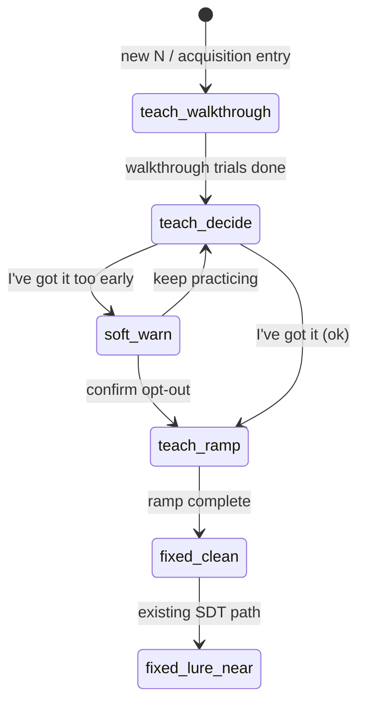

# Cyclic reveal-first teach - Plan

## Goal Capsule

Replace Cyclic’s early acquisition (`instruction → guided → fade`) with a **reveal-first teach**: short walkthrough, decide-with-reveal for active modalities, learner-paced COMPARE → REPLACE → NEXT, soft-warned **I’ve got it**, then a **speed ramp** into today’s lure/assessed path.

Authority: this plan; product shape from the 2026-08-04 brainstorm dialogue (session-settled). Supersedes plan `2026-08-03-001` R2/KTD4 “contents stay hidden” **for acquisition only**.

Open blockers: none (defaults recorded under Assumptions).

---

## Product Contract

### Summary

Cyclic goes too fast from trial 1 and does not build intuition for compare → replace → next. Acquisition becomes an interactive teach with temporary content reveals, then compresses toward assessed pace after the learner opts out. Free-play and Match% Adaptive stay unchanged.

### Requirements

- R1. Cyclic-only: Free-play and Match% Adaptive behavior, ladders, and UI paths are unchanged.
- R2. On each newly introduced fixed-track N (including after N↑), run reveal-first acquisition before any assessed lure/speed stage.
- R3. Teach reveals the **comparison target** for every **active modality** in the current mode (Dual/Tri/Quad): outline the remembered board cell for position; show the remembered letter (or equivalent token) for auditory/visual letter streams.
- R4. Acquisition sequence: short **walkthrough** (app shows correct responses) → **decide-with-reveal** (learner presses match controls; reveals stay on) → **I’ve got it** → hide reveals and run a **speed ramp** → enter existing `fixed_clean` (then lure/speed/mastery as today).
- R5. During teach, COMPARE → REPLACE → NEXT advances only on learner **Continue** (not auto 280/560 ms flashes).
- R6. **I’ve got it** is available after the walkthrough ends; if tapped “very early” in decide-with-reveal, show a soft warning once, then allow confirm.
- R7. Success criterion is **subjective clarity** (trial 1 is understandable; opt-out feels earned) — not a new SDT/Match% gate on teach completion.
- R8. Assessed stages never reveal stored slot contents; pointer may still fade/off per existing assessed rules.
- R9. Teach blocks remain non-assessed: no SDT promotion/demotion; Match % display-only if shown.
- R10. Product copy still claims cyclic updating under load — never IQ / far transfer.
- R11. Docs (`docs/adaptive-mode.md`, README Cyclic section) describe reveal-first acquisition and the intentional teach-only override of hidden contents.

### Actors

- A1. Trainee using Cyclic path (primary).

### Key Flows

- F1. New N / reset to acquisition → walkthrough trials (Continue per micro-step) → decide-with-reveal → optional soft warn → I’ve got it → speed ramp block(s) → first assessed block at `fixed_clean`.
- F2. Mid-decide opt-out early → soft warn → confirm or keep practicing.
- F3. After fixed mastery / flexible track: unchanged from current Cyclic (out of this plan’s teach rewrite).

### Acceptance Examples

- AE1. New Dual Cyclic at N=2: first trials pause on COMPARE/REPLACE/NEXT with Continues; remembered square outlined and remembered letter shown during teach; walkthrough indicates correct matches.
- AE2. After walkthrough, trainee decides matches while reveals remain; tapping I’ve got it immediately shows a soft warn; confirming hides reveals and starts the speed ramp.
- AE3. After ramp, assessed lure stages behave as today (no content reveals; SDT gates unchanged).
- AE4. Switching to Free-play or Match% Adaptive never shows teach reveals or Cyclic stage HUD.

### Key Decisions

- KD1. Reveal-first acquisition — (session-settled: user-directed — chosen over content-hidden slow teach and separate lesson sandbox): board/letter reveals during teach for intuition. Governs R3–R5, R8, R11.
- KD2. Soft early-opt-out warn — (session-settled: user-directed — chosen over hard minimum practice and trust-with-no-warn): button available after walkthrough; warn if very early. Governs R6–R7.
- KD3. Replace early stages — (session-settled: user-approved — chosen over front-load-then-keep-guided and whole-track reshape): teach+ramp *is* acquisition; then join lure/assessed. Governs R2, R4.
- KD4. Subjective clarity success — (session-settled: user-directed — chosen over behavioral collapse gates): no new promote metric on teach exit. Governs R7, R9.

### Scope Boundaries

**In scope:** Cyclic acquisition stage model + persistence migration; teach orchestration; learner-paced op HUD; modality reveals; App/StrategyInstruction wiring; docs.

**Deferred for later:** Pointer-resumption diagnostics; post-error probes; cross-wrapper transfer; flexible-lag redesign; mid-session reload resume of in-progress teach micro-state.

**Deferred to Follow-Up Work:** Exact polish of warn copy / animation; optional “re-open teach” control after opt-out within the same N.

**Outside this product's identity:** Far-transfer / IQ claims; changing Match% Adaptive or Free-play pedagogy.

### Assumptions

- A1. Walkthrough length default: `max(3, n)` trials (planning default; tune in implementation if too long/short).
- A2. Soft-warn threshold: fewer than `walkthroughLength + 3` decide trials counts as “very early.”
- A3. Speed ramp: one or two non-assessed blocks that hide reveals, keep slot pointer at reduced salience or off by last ramp block, and compress ISI from comfortable toward the existing tier-0 → tier-1 boundary before `fixed_clean` (exact ms curve deferred to implementer within `ISI_TIER_BASE_MS`).
- A4. Letter reveal UI is a compact on-board or HUD token (not TTS-only); position reveal is a secondary outline on the remembered cell distinct from the current stimulus highlight.
- A5. Learners stuck on legacy `guided`/`fade` stages migrate into the new decide/ramp acquisition stage (not reset to N=2).

---

## Planning Contract

### Product Contract preservation

Product Contract authored in this bootstrap from the 2026-08-04 brainstorm dialogue. No prior requirements-only unified plan existed. Intentionally supersedes `docs/plans/2026-08-03-001-feat-adaptive-cyclic-curriculum-plan.md` R2 / KTD4 hidden-contents rule for acquisition only.

### Key Technical Decisions

- KTD1. Replace `instruction` / `guided` / `fade` with explicit acquisition stages `teach_walkthrough` → `teach_decide` → `teach_ramp`, then `fixed_clean`… — (session-settled product KD3). Keep framework-free mapping in `src/model/adaptiveCurriculum.ts`. Persist with alias migration + schema bump to **v4** for cyclic ladder.
- KTD2. Teach progression is **user-action driven** in `gameStore` (Continue micro-steps, I’ve got it, ramp block end), not unconditional `advance_acquisition` on every block end. Assessed path keeps `decideCurriculumProgression`.
- KTD3. Learner-paced ops: extend `SlotPointerHud` with a teach pacing mode (`opStep` + Continue) instead of stimulus-tied 280/560 ms timeouts during acquisition.
- KTD4. Reveals are **display-layer**: expose active-slot stored values via a narrow teach accessor from session/history (do not omit generation). Assessed stages keep reveals off.
- KTD5. Soft warn is UI+store counter only; no ladder demotion.

### High-Level Technical Design



Teach trial micro-loop (directional):

```text
stimulus onset
→ show reveals for active modalities (stored slot vs current)
→ wait Continue: COMPARE
→ wait Continue: REPLACE
→ wait Continue: NEXT
→ (walkthrough: show correct match hints; decide: score real presses)
→ next trial or phase transition
```

### Alternatives Considered

- Keep guided/fade and only lengthen ISI — rejected; does not teach the operation or pause micro-steps.
- Content-hidden learner-paced only — rejected in brainstorm (Approach B).
- Separate lesson sandbox outside Cyclic — rejected (Approach C).

### Risks & Dependencies

| Risk | Mitigation |
|------|------------|
| Reveals train “match the outline” not retrieval | Hard hide after opt-out; ramp before assessed; docs state teach-only scaffold |
| No visual letter surface today | U3 adds letter token; audio still plays |
| Stage rename resets progress | v4 + alias map for `guided`/`fade`/`instruction` |
| Teach timing fights Game ISI clock | Pause/advance trial clock only on Continue during teach, or use short scripted teach trials with frozen ISI until Continue — pick one in U2 and cover with tests |
| Haptics on match buttons during slow teach | Keep `.haptic-host` pattern (`docs/solutions/.../dual-platform-web-haptics-match-controls.md`) |

### Open Questions

- OQ1 (deferred): Exact warn copy and whether warn appears only once per N. Default: once per acquisition entry.
- OQ2 (deferred): Whether ramp keeps a faint slot pointer. Default: pointer `fade` on first ramp block, `off` on last.

---

## Implementation Units

### U1. Curriculum acquisition stages + persistence

**Goal:** Model reveal-first acquisition stages and migrate stored ladders.

**Requirements:** R2, R4, R8, R9; KD3; KTD1

**Dependencies:** none

**Files:**
- Modify: `src/model/adaptiveCurriculum.ts`
- Modify: `src/model/adaptiveController.ts`
- Modify: `src/model/ladderPersistence.ts`
- Modify: `src/model/adaptiveCurriculum.test.ts`
- Modify: `src/model/adaptiveController.test.ts`
- Modify: `src/model/ladderPersistence.test.ts`
- Modify: `src/components/adaptiveDisplay.ts`
- Modify: `src/components/adaptiveDisplay.test.ts`

**Approach:**
1. Replace early fixed stages with `teach_walkthrough` / `teach_decide` / `teach_ramp`; update `FIXED_STAGES`, `advanceAcquisition`, `pointerModeForStage`, `blockRoleForStage`, `isAssessedStage`.
2. Teach stages: `assessed: false`; variable N off; lureStage A; ISI comfortable on walkthrough/decide; ramp uses progressive ISI tiers per A3.
3. Controller: teach block roles never SDT-promote; ramp block end advances toward `fixed_clean`; decide/walkthrough do not auto-skip to assessed without opt-out / ramp completion rules defined with U2.
4. Persistence: `CYCLIC_LADDER_SCHEMA_VERSION = 4`; map legacy `instruction`→`teach_walkthrough`, `guided`→`teach_decide`, `fade`→`teach_ramp`.

**Patterns to follow:** Existing `settingsFromCurriculum` / `advanceAcquisition` purity in `adaptiveCurriculum.ts`.

**Test scenarios:**
- Happy: default ladder starts at `teach_walkthrough`; stage helpers map walkthrough/decide/ramp as non-assessed with correct pointer/ISI defaults.
- Edge: legacy persisted `guided` normalizes to `teach_decide` under v4.
- Edge: assessed stages still report `assessed: true` and `pointerMode: 'off'`.
- Integration: controller never SDT-promotes teach roles; decide→ramp is user-action (U2), not unconditional block-end advance.

**Verification:** Curriculum/controller/persistence unit tests green; unknown stage still safe-falls back.

### U2. Teach orchestration in session/store

**Goal:** Wire learner-paced phases, I’ve got it, soft warn, and ramp completion into Cyclic start/end.

**Requirements:** R4–R7, R9; KD2, KD4; KTD2, KTD5

**Dependencies:** U1

**Files:**
- Modify: `src/store/adaptiveSession.ts`
- Modify: `src/store/adaptiveSession.test.ts`
- Modify: `src/store/gameStore.ts`
- Modify: `src/store/gameStore.test.ts`
- Possibly modify: `src/store/GameSession.ts` / `src/model/Game.ts` (narrow teach accessor for stored slot values — coordinate with U3)

**Approach:**
1. Extend block config / session flags: teach phase, micro-step index, decideTrialCount, warnShown.
2. Replace `acknowledgeStrategyInstruction` with start-walkthrough (or map instruction acknowledgment into launching teach_walkthrough play).
3. Actions: `advanceTeachOp` (Continue), `acknowledgeTeachOptOut` (I’ve got it → warn or enter ramp), `confirmTeachOptOut`.
4. Freeze or gate trial advancement so COMPARE/REPLACE/NEXT are learner-paced (KTD3 pairing with U3).
5. On ramp block end → `fixed_clean` via acquisition advance; do not SDT-score teach for promotion.

**Execution note:** Characterization coverage of current cyclic `startGame` / `finalizeGameEnd` / `acknowledgeStrategyInstruction` before changing wiring.

**Patterns to follow:** `acknowledgeStrategyInstruction` + `processCyclicBlockEnd` split between user action and assessed progression.

**Test scenarios:**
- Happy: walkthrough completes → decide; opt-out after enough trials → `teach_ramp` without warn.
- Edge: early opt-out sets warn; second confirm enters ramp.
- Edge: Free-play / adaptive paths never expose teach actions.
- Integration: after ramp completion next block config is `fixed_clean` assessed.

**Verification:** `pnpm test -- src/store/gameStore.test.ts src/store/adaptiveSession.test.ts`.

### U3. Learner-paced HUD + modality reveals

**Goal:** CONTINUE-paced ops and display-layer reveals for active modalities.

**Requirements:** R3, R5, R8; KD1; KTD3, KTD4

**Dependencies:** U2 (session flags / stored-slot accessor)

**Files:**
- Modify: `src/components/SlotPointerHud/index.tsx`
- Modify: `src/components/SlotPointerHud/SlotPointerHud.scss`
- Modify: `src/components/SlotPointerHud/SlotPointerHud.test.tsx`
- Modify: `src/components/Board/BoardSquare.tsx` (and/or Board overlay)
- Create as needed: small letter-reveal presentational component under `src/components/`
- Modify: `src/App.tsx` (wire teach props / Continue control)

**Approach:**
1. Add teach pacing props: current op, onContinue, revealPayload (per modality).
2. Disable auto timeouts when teach pacing is active; show Continue CTA.
3. Position: outline remembered index differently from current stimulus highlight.
4. Letter/audio token: visible glyph for stored vs current during teach only.
5. When stage assessed / reveals off: existing HUD behavior (or off).

**Patterns to follow:** `VariableNHud` aria-live; BoardSquare stimulusEpoch highlight; haptics host pattern for match buttons unchanged.

**Test scenarios:**
- Happy: teach mode shows COMPARE until Continue advances to REPLACE.
- Happy: position outline targets stored cell, not only current stimulus.
- Edge: `pointerMode === 'off'` still hides HUD on assessed.
- Edge: Tri/Quad only reveals modalities present in mode config.

**Verification:** Component tests + manual Dual smoke on device/browser.

### U4. Walkthrough / opt-out UI copy

**Goal:** Replace static StrategyInstruction with teach shell (walkthrough hints + I’ve got it + soft warn).

**Requirements:** R4, R6, R7, R10; KD2

**Dependencies:** U2, U3

**Files:**
- Modify: `src/components/StrategyInstruction/index.tsx` (or replace with TeachCoach panel)
- Modify: `src/components/StrategyInstruction/StrategyInstruction.scss`
- Modify: `src/App.tsx`
- Modify: `src/components/SettingsPanel/index.tsx` (stage labels if shown)

**Approach:**
1. Pre-play blurb can remain short; primary teach happens in-session.
2. Surface I’ve got it + warn dialog during `teach_decide`.
3. Walkthrough: show correct match hints without claiming IQ gains.

**Test scenarios:**
- Happy: I’ve got it visible only after walkthrough.
- Edge: soft warn copy appears once on early opt-out.
- Covers AE1 / AE2 at UI wiring level where practical.

**Verification:** Store+UI tests; spot-check App gating for idle vs in-session.

### U5. Docs alignment

**Goal:** Document reveal-first acquisition and teach-only content reveal.

**Requirements:** R11, R10

**Dependencies:** U1–U4 behavior settled

**Files:**
- Modify: `docs/adaptive-mode.md`
- Modify: `README.md` (Cyclic section)

**Approach:** Rewrite Cyclic teach section: walkthrough → decide-with-reveal → opt-out → ramp → assessed; note supersession of hidden-contents-during-teach; keep “no IQ claims.”

**Test expectation:** none -- documentation only.

**Verification:** Docs match shipped stage names and user-visible copy.

---

## Verification Contract

- `pnpm test` (full Vitest suite)
- Targeted while iterating: `pnpm test -- src/model/adaptiveCurriculum.test.ts src/model/adaptiveController.test.ts src/model/ladderPersistence.test.ts src/store/gameStore.test.ts src/components/SlotPointerHud`
- Manual: Cyclic Dual new-N path through I’ve got it → first assessed block; confirm Free-play / Adaptive untouched

## Definition of Done

- [ ] Early Cyclic stages are reveal-first teach + ramp; lure/assessed path unchanged after entry to `fixed_clean`
- [ ] Learner-paced COMPARE → REPLACE → NEXT Continues during teach
- [ ] Active-modality reveals on during teach, off after opt-out / assessed
- [ ] Soft warn on early I’ve got it; subjective opt-out advances to ramp
- [ ] Legacy guided/fade/instruction ladders migrate without wiping N
- [ ] Docs updated; no IQ/far-transfer claims
- [ ] Tests above green

## Appendix

### Sources & Research

- Brainstorm dialogue 2026-08-04 (reveal-first Approach A; soft warn; replace early stages; subjective clarity).
- Research briefs: `~/Downloads/deep-research-report (4).md` (cyclic one-update); prior plan research notes in `docs/plans/2026-08-03-001-feat-adaptive-cyclic-curriculum-plan.md`.
- Repo patterns: `src/model/adaptiveCurriculum.ts`, `SlotPointerHud`, `StrategyInstruction`, `gameStore` cyclic wiring.
- Institutional: `docs/solutions/design-patterns/dual-platform-web-haptics-match-controls.md` (match control haptics during teach).
- External research this run: skipped — approach settled; local Cyclic patterns sufficient for HOW.
